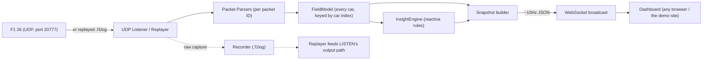
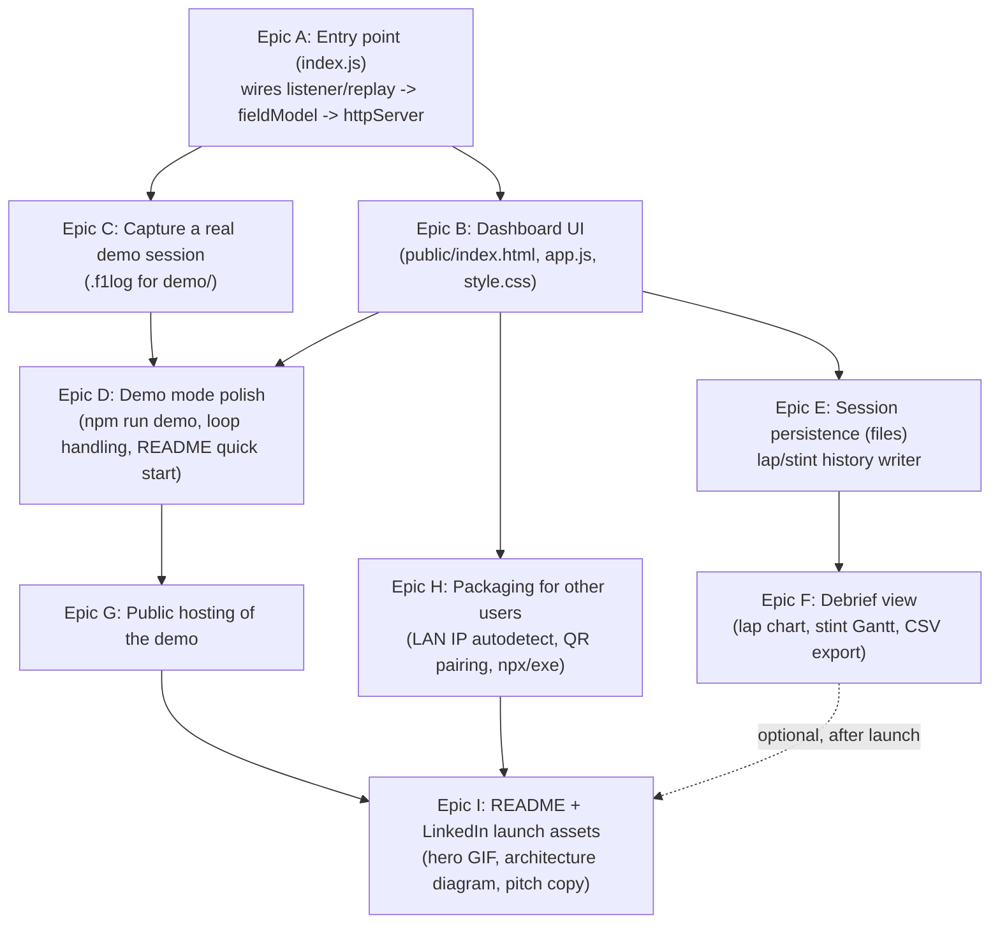

# F1 26 Race Engineer — Engineering Spec

## 1. Vision

A live race-engineer dashboard for F1 26, driven by the game's UDP telemetry, viewable on a second
device (tablet, phone, laptop or second monitor) over the LAN. Two audiences, both load-bearing on the design:

1. **The driver (primary user)** — needs reactive, glanceable, *relative-to-the-field* insights while
   actually driving: pit timing, tyre/fuel risk, pace trend vs. the cars around them.
2. **Recruiters / other sim racers (distribution audience)** — will encounter this as a public GitHub
   repo linked from LinkedIn. Most will never run the game. The project must demonstrate real
   engineering (protocol parsing, real-time architecture, data pipeline, UX judgment) and be
   *experienceable* without installing anything, via a hosted demo replaying recorded data.

## 2. Success criteria

- Driving: at a glance, the driver always knows (a) what to do next (pit / hold / push) and (b) what
  immediate threats exist (car behind closing, tyre cliff, fuel short, safety car).
- Sharing: a stranger can clone the repo and have the dashboard running against their own F1 26 session
  in under 5 minutes, with no code changes.
- Portfolio: a recruiter can click one link and see the dashboard live-updating with realistic data,
  with no install, no game, no explanation needed.

## 3. Non-goals (explicitly out of scope for v1)

- Native iOS app (the LAN web-dashboard approach avoids iOS's multicast/UDP restrictions entirely —
  see "Why a bridge, not a native app" below).
- Setup/car-tuning advice (Car Setups packet) — strategy and situational awareness only.
- Multi-session cloud sync / accounts — local-only persistence (a file per session) for v1.

## 4. Architecture



**Why a bridge process, not a native iOS app:** iOS restricts raw UDP broadcast/multicast listening
(multicast needs a special Apple entitlement). A small server on the same PC as the game receives the
UDP stream directly (`127.0.0.1`, no multicast involved) and re-serves derived state over WebSocket —
any device then just needs a browser. This sidesteps the restriction entirely and is also what makes a public,
install-free demo possible later.

**Why FieldModel tracks every car, not just the player's:** "pace relative to everyone around me" and
undercut detection are impossible from player-only state — Lap Data and Car Telemetry packets already
contain *all* cars each tick, so this is a modeling decision, not a new parsing cost.

**Why a shared `parsePacket()` entry point:** both the live UDP listener and the recorded-session
replayer must produce byte-identical behavior, or the public demo wouldn't represent the real tool.
One parse function, two feeders (`listener.js`, `capture/replay.js`).

## 5. Directory scaffold (current state)

```
f1-race-engineer/
├── package.json                      [DONE] deps: ws, qrcode-terminal. Scripts: start, record, capture, analyze, accuracy,
│                                            train:overtake, demo, demo:regenerate, test
├── PROJECT_SPEC.md                   [DONE] this file
├── README.md                         [DONE, v1] quick start, game settings, architecture, pitch. Needs hero GIF (Epic I)
├── LICENSE                           [DONE] MIT
├── src/
│   ├── index.js                      [DONE] entry point: listener OR replay -> fieldModel -> httpServer.
│   │                                        Flags: --demo, --speed, --record, --capture, --capture-dir, --port, --udp-port, --udp-host
│   ├── udp/
│   │   ├── bufferReader.js           [DONE] sequential little-endian reader
│   │   ├── packetIds.js              [DONE] packet ID enum (0-16)
│   │   ├── parsePacket.js            [DONE] header + dispatch, shared by live+replay. 22 car slots, 24 from format 2026
│   │   ├── listener.js               [DONE] dgram socket -> parsePacket -> onPacket callback
│   │   └── parsers/
│   │       ├── header.js             [DONE] 29-byte header
│   │       ├── carTelemetry.js       [DONE] all cars
│   │       ├── carStatus.js          [DONE] all cars
│   │       ├── carDamage.js          [DONE] all cars. Stride-detects the F1 25 tyreBlisters[4] field - VERIFY (§11)
│   │       ├── lapData.js            [DONE] all cars
│   │       ├── participants.js       [DONE, BEST-EFFORT] names via null-termination - VERIFY (§11)
│   │       ├── session.js            [DONE] skips the fixed MarshalZone[21] array to reach safetyCarStatus
│   │       ├── event.js              [DONE] code -> label; SCAR detail (VSC/SC, deployed/ending)
│   │       ├── carSetups.js          [DONE] all cars - brake bias / diff for live adjustments
│   │       ├── motionEx.js           [DONE] player only - wheel slip for lockup/wheelspin detection
│   │       ├── tyreSets.js           [DONE] per-car tyre sets (cycles through cars)
│   │       ├── carTelemetry2.js      [DONE] F1 26 only - active aero + Overtake mode
│   │       ├── finalClassification.js [DONE] the official result (Debrief; ends the session)
│   │       ├── sessionHistory.js     [DONE] one car per packet: every lap and sector time (field best sectors)
│   │       └── lapPositions.js       [DONE] every car's position at the start of each lap (position chart)
│   ├── state/
│   │   ├── fieldModel.js             [DONE] per-car state; resets on new sessionUID or replay loop;
│   │   │                                    game-time gap history; latched pit entry; staleness
│   │   ├── lapDelta.js               [DONE] live delta to the player's PB lap (distance/time trace)
│   │   ├── lapTrace.js               [DONE] inputs vs distance per lap, every car (feeds lap compare)
│   │   ├── raceAnalysis.js           [DONE] clean-lap pace, gap trends, measured pit loss, rejoin prediction
│   │   ├── race.js                   [DONE] shared race-distance helpers
│   │   ├── weather.js                [DONE] forecast -> laps; drying track; inters/slicks crossover
│   │   ├── carBalance.js             [DONE] per-corner lockup / wheelspin / understeer memory
│   │   ├── adjustments.js            [DONE] brake bias / diff / ERS suggestions
│   │   ├── debrief.js                [DONE] lap-by-lap record kept after the session; saved to data/sessions/
│   │   ├── trackMemory.js            [DONE] per-track pit loss, AI stop timing and wear rates; data/tracks.json
│   │   ├── focus.js                  [DONE] which screen matters now, for auto-switch (with hold times)
│   │   └── insightEngine.js          [DONE] radio-call rules + strategy summary (PUSH/HOLD/BOX)
│   ├── analysis/                     [DONE] battleCall, attackForecast, batteryProjection, strategyOptions (SC/VSC),
│   │                                        pitTiming (which lap to box on), rivalStops (when each car boxes),
│   │                                        damageLoss (what damage costs, from mini-sectors),
│   │                                        qualifying (practice / qualifying lap view), lapCompare, rivals,
│   │                                        tyreTemps (against your own laps), racePlan (one stop or two)
│   ├── ml/                           [DONE] logistic.js (from scratch), overtakeFeatures.js, tyreModel.js, models/*.json
│   ├── capture/
│   │   ├── logFile.js                [DONE] .f1log(.gz) read/write
│   │   ├── session.js                [DONE] --capture folder: packets, outputs, driver marks
│   │   ├── analyze.js                [DONE] validates a capture, calibrates thresholds, writes report.md/json
│   │   ├── recorder.js               [DONE] raw packet -> timestamped line in a .f1log file
│   │   └── replay.js                 [DONE] wall-clock-scheduled replay, loops, onLoopStart hook
│   ├── sim/
│   │   ├── encoders.js               [DONE] inverse of the parsers (F1 25 layout) - tests + generator
│   │   └── syntheticSession.js       [DONE] scripted 5-lap stint used as the demo until a real capture exists
│   └── server/
│       ├── snapshot.js               [DONE] FieldModel + InsightEngine -> wire payload (§6)
│       ├── httpServer.js             [DONE] static files + WebSocket at 10Hz (http, or https with a cert); LAN URLs + QR
│       └── qr.js                     [DONE] QR code (terminal + SVG) of the LAN address
├── public/                           [DONE] Epic B dashboard - plain HTML/CSS/JS, no build
│   ├── index.html                           shell: screen tabs, custom-screen editor, settings, radio band/toasts
│   ├── manifest.json, icon-*.png            Add to Home Screen
│   ├── ask.js                               "Ask the engineer": question -> one-sentence answer from the snapshot
│   ├── widgets.js                           the live widgets (drive, battle, radio, call, rejoin, options, ...); formatting only
│   ├── debrief.js                           the Debrief widget: recap, lap compare, rivals, models
│   ├── app.js                               6 screens + layouts, custom screen, auto-switch, settings, voice + Ask, WebSocket client
│   └── style.css                            dark cockpit theme; every card a size container, cq-scaled type
├── scripts/
│   ├── generate-demo-session.js      [DONE] writes demo/synthetic-session.f1log (gitignored, ~17MB)
│   ├── analyze-capture.js            [DONE] npm run analyze
│   ├── train-overtake.js             [DONE] npm run train:overtake (from captures/)
│   ├── accuracy.js                   [DONE] npm run accuracy: predictions vs what happened -> docs/accuracy.md
│   └── build-demo-site.js            [DONE] npm run site: records the engine's snapshots for the demo website
├── docs/                             how-it-works, ux, accuracy, ml-overtake-model
├── site/                             demo website: index.html (landing page) + race-data/ (a real race: the live screens and the Debrief)
├── .github/workflows/pages.yml       tests, builds the recording (npm run site), publishes to GitHub Pages
├── test/                             [DONE] node:test - parser round-trips, state + insight rules
├── demo/                             [PARTIAL] synthetic session generated on demand; real capture still TODO (Epic C)
├── captures/                         npm run capture output (gitignored)
└── data/sessions/                    saved Debrief sessions, one .json.gz each (gitignored)
```

`scripts/record-session.js` from the original plan was replaced by `npm run record -- <file>` (the
`--record` flag on the entry point), which records while the dashboard runs.

## 6. Data contract (wire payload, ~10Hz over WebSocket)

```
{
  source: 'live' | 'demo',
  connected: bool,                 // false when no packets for 2s (paused/menu); last state still sent
  updatedAtMs: number,
  session: { weather, trackTemperature, airTemperature, totalLaps, trackLength, safetyCarStatus, ... },
  player: {
    name, position, currentLapNum, lastLapTimeInMS,
    bestLapTimeInMS, deltaToBestMs, previousLapTimeInMS, deltaToLastMs, liveMiniSectors, paceMs,
    lapDistance, pitStatus, numPitStops, speed, fuelInTank, fuelRemainingLaps,
    tyreCompound /* visual: 16 S, 17 M, 18 H, 7 I, 8 W */, tyresAgeLaps, tyresWear[4]
  },  // only what the dashboard or capture analyzer reads; HUD values stay server-side
  field: [ { carIndex, position, name, teamId, isPlayer, gapToPlayerMs /* signed: negative = ahead */,
             intervalMs, lastLapTimeInMS, paceMs /* avg of last 3 clean laps */,
             gapTrendMsPerLap /* change in |gap| per lap, negative = shrinking */, lapsToDrs, lapsToCatch,
             tyreCompound, tyresAgeLaps, numPitStops, pitStatus, running,
             stopInLaps /* expected stop, laps from now (0 = this lap), or null */,
             topSpeedKmh /* last green lap */ }, ... ],  // whole grid, by position
  nearby: [ ...same shape as field... ],                     // up to 2 ahead, 2 behind
  analysis: {
    pitLoss: { ms, normalMs, neutralised, source: measured|earlier races here|track estimate|generic estimate, samples, lastMeasuredFrom },
    rejoin: { position, positionsLost, inTraffic, ahead: { carIndex, name, gapMs, tyreCompound, tyresAgeLaps },
              behind: { ... } } | null,                      // null in the pits, or while gaps are unknown
    options: { situation, lapsLeft, freeStop, options: [ ... ] } | null,   // only under SC / VSC / red flag
    pitTiming: { bestId, bestInLaps, cheapestInLaps, marginS, headline, label,
                 options: [ { id: box-<k>|stay, inLaps, compound, compoundName, rejoinPosition, inTraffic,
                              finishPosition, lossS, best } ],
                 stops: [ { name, position, inLaps } ] } | null,   // green flag, dry, tyre data trusted
    damage: { parts: [ { label, pct, fixable } ], sinceLap, fixableShare,
              lossPerLapMs /* null while measuring */, basis: laps|partial|measuring|no-baseline, lapsMeasured,
              where: [corner], toFlagMs, fix: { costMs, savedMs, stopAnyway, pays } } | null,
    penalties: { timeS, servedAt: stop|flag, driveThroughs, stopGos,
                 trackLimits: { count, last: { corner } | { atM } | null, sameAgain },
                 flag: { name, gapMs, covered } | null } | null,   // null: no penalties, no warnings
    tyreTemps: { coldByC, hot: { axle: front|rear, byC } | null } | null,   // against your own laps
    racePlan: { best, other /* + slowerMs */: { stops, stints: [ { compound, laps, setIndex } ], boxLaps, totalMs },
                degSource: { [compound]: this session|earlier sessions here|estimate } } | null,   // race, lap <= 1, dry
    quali: { kind: practice|qualifying|time trial, name, status: garage|out|flying|in|track, lapInvalid,
             timeLeftS, position, bestMs, poleMs, gapToPoleMs, cut: { position, lineMs, marginMs } | null,
             projected: { lapMs, position, improves } | null, toLine: { startsInS, spareS, makesIt } | null,
             runs, traffic: { ahead, behind /* { name, gapS, status } */ } } | null,   // null in a race
    weather: { trackState, nextChange, timeline[], accuracy, ...,
               crossover: { wetGainMs, basis: switchers|groups, switchers, wetCars, slickCars, wetMs, slickMs } } | null,
    battle: { attack, defend /* ML: { p, level } */, attackForecast, defendForecast, call,
              battery: { you, ahead, behind /* { nowPct, atLinePct, trendPctPerLap, basis } */ } },
    tyreModel: { compounds, mine, payback }, regs2026, overtake
  } | null,
  insights: [ { id, severity: info|advisory|critical, category: pace|strategy|health|flag, message,
                createdAtMs, expiresAtMs }, ... ],            // sorted most severe first; [0] is the banner
  strategy: { lapsRemaining, fuelMarginLaps, fuelSavePct /* % of a lap's fuel to save, when short */, tyreLapsToCliff, tyreWearRatePerLap, battle /* ATTACK|DEFEND|... */,
              call: { action: PUSH|HOLD|BOX|PIT|PREP /* PREP: out lap, qualifying */, reason } } | null,
  adjust: { current, suggestions: [ { id, kind: bias|diff|ers, action, where, why } ] } | null,
  focus: { screen: drive|battle|strategy|weather|debrief, reason, sinceMs } | null,   // auto-switch
  capturing: bool,
  debrief: { sessions: [ ... ] }   // about once a second, not every tick
}
```

Per-tyre arrays use the game's order: `[RL, RR, FL, FR]`.

This is the entire frontend contract — `public/app.js` should not need to compute anything beyond
formatting; all judgment happens server-side in `insightEngine.js`.

## 7. Dashboard UX requirements (`public/`)

The full reasoning is in [docs/ux.md](docs/ux.md). In short: nothing the game's HUD or MFD already
shows (speed, gear, temperatures, wear %, fuel, damage, the tower, the delta are all on screen in the
game); the decision is the biggest thing on the screen; colour only means something. Screens: Drive
(the glance screen), Battle, Strategy, Weather, Custom, and Debrief (post-session, backed by
`data/sessions/`). Auto-switch (off by default) moves between them on `snapshot.focus`.

Alert UX: insights render as transient "radio call" toasts (severity-colored, auto-expire per their
`expiresAtMs`), not permanent gauges — critical severity should visually interrupt (full-width banner),
info severity should be unobtrusive (corner toast).

Must support iPad portrait and landscape; dark theme only (cockpit-at-night contrast); no dependency on
a backend framework — plain HTML/CSS/JS is sufficient and keeps the "share with others" bar low.

## 8. Non-functional requirements

- **Performance**: bridge must not perceptibly affect game frame rate. Budget: parse + state update
  per UDP packet should stay well under 1ms; outbound WebSocket tick fixed at 10Hz regardless of the
  game's UDP rate (up to 60Hz) to cap both CPU and iPad battery/render load.
- **Resilience**: a struct-layout drift in one packet type (EA adds a field) must degrade to a console
  warning for that packet type only, never crash the process. Already implemented via length-mismatch
  checks in the parsers — preserve this pattern in any new parser.
- **Zero required config for the common case**: default UDP port 20777, default HTTP port 8080,
  auto-bind to all interfaces so the LAN IP just works.

## 9. Packaging & distribution (the LinkedIn/recruiter requirement)

- **Repo as the pitch**: README needs a hero GIF of the live dashboard, the architecture diagram above,
  a "Try the live demo" link, a 2-minute quick start, and a short "what this demonstrates" section
  (binary protocol parsing, real-time streaming architecture, reactive rules engine, data
  capture/replay pipeline, UX design under a glanceability constraint).
- **Public demo**: `demo/*.f1log` (one recorded real session, committed to the repo) + `npm run demo`
  replays it through the *real* pipeline into the *real* dashboard. The same demo build gets deployed
  to a public URL (static host + a small always-on replay process, or a serverless WebSocket) so a
  recruiter clicks a link and sees it moving — no clone, no install. Hosting choice is an open decision,
  flagged in §11.
- **For other sim racers**: `npx` or packaged start script that auto-detects the LAN IP and prints/QR's
  the dashboard URL, so pairing a device doesn't require typing an IP address.
- **License**: MIT, so "download and use it yourself" is frictionless.

## 10. Build order / dependency graph



**Critical path to "usable by me while driving": A → B.** (A and B done as of 2026-10-15; next: C - capture a real session.)
**Critical path to "shareable on LinkedIn with a live demo": A → B → C → D → G → I.**
Epics E/F (persistence + debrief) are valuable but not on either critical path — sequence them after
the live tool and the public demo both work, not before.

## 11. Open decisions (need a call before those epics start)

- **Demo hosting** (Epic G): decided - a static GitHub Pages site (`site/`, `.github/workflows/pages.yml`).
  The real dashboard plays a recording the real engine makes at build time (`npm run site`), and is
  labelled "Recorded demo" so it never passes for a live session. Free, nothing to keep running.
- **Persistence** (Epic E): decided - one gzipped JSON file per session in `data/sessions/`, not
  SQLite: the debrief already holds the whole session in memory, so a file write at the end is all it
  needs, with no native dependency to install.
- **Verify against the first real F1 26 capture** (do this before Epic C is called done). The
  parsers and the synthetic demo both follow the F1 25 spec; three assumptions specifically need a
  real packet to confirm:
  1. *Car Damage layout* - `tyreBlisters[4]` is assumed to sit after `brakesDamage` (stride 46). If
     wing/engine damage reads as nonsense, the insertion point is wrong.
  2. *`fuelRemainingLaps` semantics* - the fuel rule treats it as laps of fuel in the tank. If the game
     actually reports the MFD's +/- surplus figure, the rule must compare it to 0 rather than to laps
     remaining (it would currently report every race as several laps short).
  3. *F1 26 packet format number* - the README tells users to pick format "2025 or later"; confirm
     what F1 26 offers and that struct sizes match (parsers warn on mismatch).
- **Participants packet accuracy** (existing risk, not a new decision): name-field parsing is
  best-effort; verify against one real capture before relying on driver names in the dashboard or
  undercut-threat messages.
