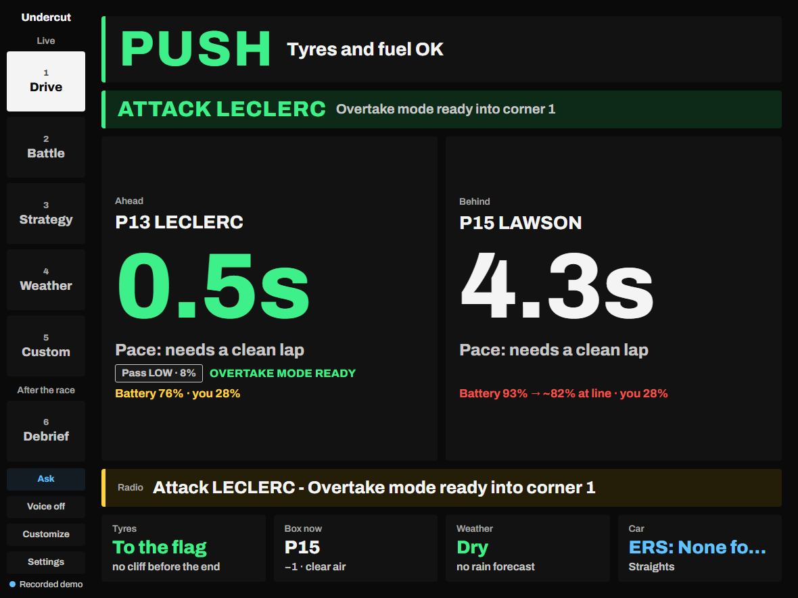
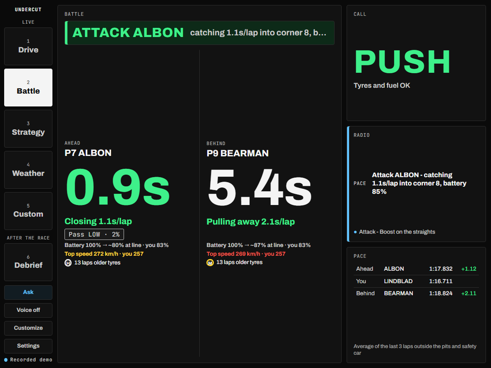
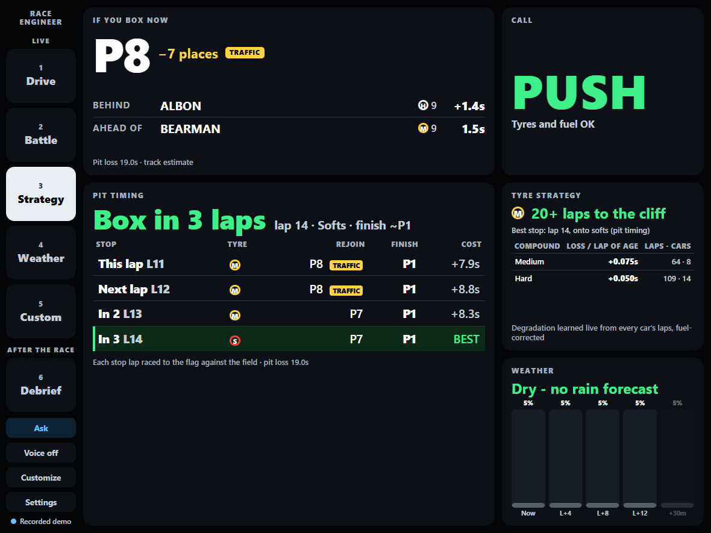
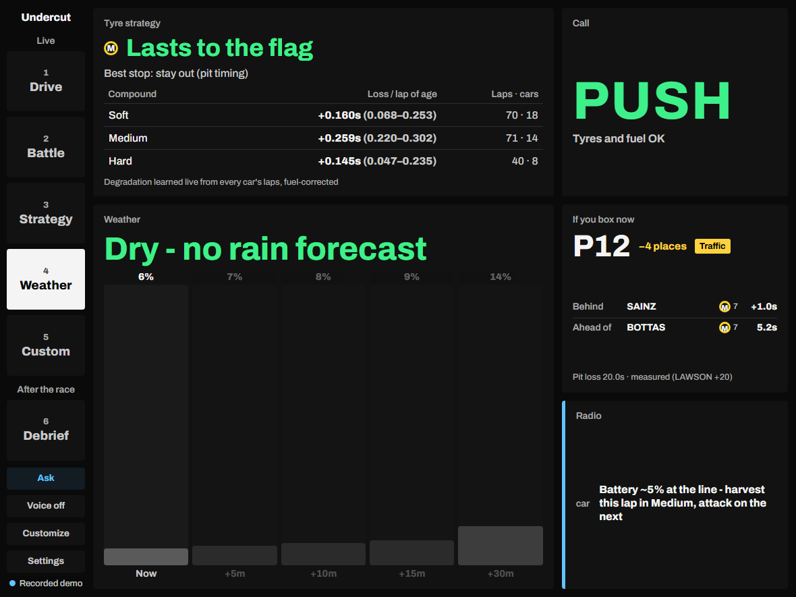
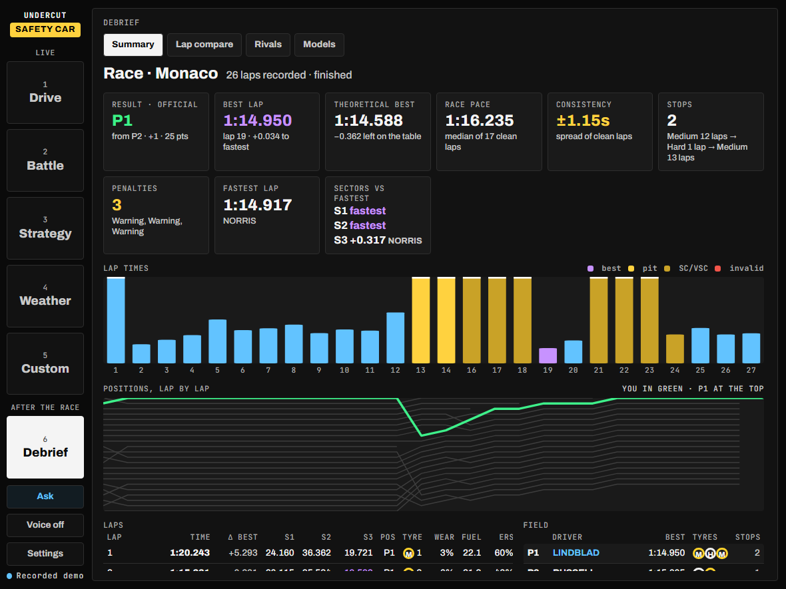
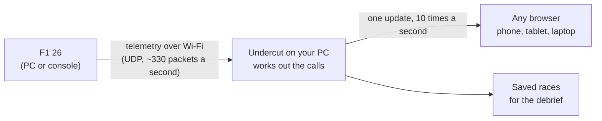

# Undercut

**A race engineer for F1 26.** It reads the game's live telemetry and tells you one thing at a time:
when to box, who to attack, when the rain is coming. You watch it on a phone or tablet next to your
screen, and it can read the calls out loud.

I built it because the in-game engineer doesn't tell you much, and everything it would need is
already in the data the game sends out. It's a student project: free, open source, and everything
runs on your own PC.

**[▶ Try the demo in your browser](https://srikarnadella.github.io/f1-race-engineer/)**: the real
dashboard replaying a race I recorded at Monaco. No install needed.



| Battle | Strategy | Weather | Debrief |
|---|---|---|---|
|  |  |  |  |

## How it fits together



The game already sends data for **every car**, not just yours. Undercut keeps track of all of it,
works out things like pit loss, tyre wear and who is about to stop, and turns that into one call:
**PUSH, HOLD or BOX**, plus short radio messages ("Defend from Albon, watch turn 1").

## Try it

You need [Node.js](https://nodejs.org) 20 or newer.

```bash
git clone https://github.com/srikarnadella/f1-race-engineer.git
cd f1-race-engineer
npm install
npm run demo        # a made-up five-lap race, no game needed
```

Then open **http://localhost:8080**. Keys **1–6** switch screens.

**With the game:** run `npm start` instead, then in F1 26 go to *Settings → Telemetry Settings* and
turn **UDP Telemetry On** (port **20777**, format **2025** or later). Scan the QR code it prints with
your phone or tablet. Full steps, options and voice setup: [docs/setup.md](docs/setup.md).

## Does it actually work?

I recorded eight race sessions in F1 26 (one a sprint) and replayed them through the engine, scoring each prediction against
what really happened, next to the obvious guess:

| Prediction | Undercut | Obvious guess |
|---|---|---|
| Tyre wear per lap (1,649 laps) | **356 ms off** | 470 ms ("no wear") |
| Where you rejoin after a stop (45 stops) | **4.22 places off** | 5.27 ("keep your place") |
| A rival's battery at the line | **8.4 points off** | 13.4 ("stays where it is") |
| Will the car behind pass in 10 s? | 0.851 AUC | 0.854 (gap only), so it's a tie |
| The same, with gradient boosting (LightGBM, 10 races, not in the app yet) | **0.860 AUC** | 0.838 (gap only), better on 9 of 10 races |

Three of the six models I score beat the obvious guess and three don't yet, and the app says so
instead of pretending. Every number is in [docs/accuracy.md](docs/accuracy.md); the LightGBM comparison is in
[docs/ml-overtake-lightgbm.md](docs/ml-overtake-lightgbm.md).

## Read more

| | |
|---|---|
| [Setup](docs/setup.md) | Using it with the game, options, voice on a tablet, recording a race |
| [The dashboard](docs/dashboard.md) | Every screen, voice questions, and everything it works out for you |
| [Models and accuracy](docs/models.md) | The machine learning, how it's scored, the calls audit, lap compare |
| [How it's built](docs/development.md) | The architecture, the tests, and every command |
| [Status and what's next](docs/status.md) | What's verified, what's still open, and what I'm building next |
| [One call, end to end](docs/how-it-works.md) | A single call followed through the code |
| [Saved race data](docs/race-store.md) | The SQL tables every session is kept in |
| [Roadmap](docs/roadmap.md) | The work plan, and what the tests found |

## Built with

Node.js (no framework, no build step), WebSockets, SQLite, and plain HTML/CSS/JavaScript for the
dashboard. The models are written from scratch. 300+ tests run on every push.

Fan project. Not affiliated with Formula 1, the FIA or Electronic Arts. MIT license.
