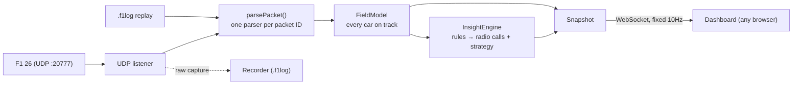

# F1 26 Race Engineer

A live race-engineer dashboard for **F1 26**, driven by the game's UDP telemetry and viewed on a
second screen: a tablet by the wheel, a phone, a laptop or a second monitor. Any browser on your network.

It doesn't just mirror numbers. It watches **the whole field** and calls what matters right now:
*box this lap*, *P8 is 0.5s behind — defend*, *Hamilton just pitted — undercut threat*, *fuel margin
down to 0.3 laps*.

**[▶ Try the interactive demo in your browser](https://srikarnadella.github.io/f1-race-engineer/)** - the real dashboard replaying a real F1 26 race at Monaco, no install.


| Battle | Strategy (pit timing) | Weather | Debrief |
|---|---|---|---|
|  |  |  |  |

**Every prediction is scored against what really happened** in recorded races, next to a naive
baseline ([accuracy](docs/accuracy.md)), and the app says so where a model doesn't beat it yet.
How it works, end to end: [docs/how-it-works.md](docs/how-it-works.md). Why the screens look the
way they do: [docs/ux.md](docs/ux.md).

## Try it in 30 seconds (no game needed)

Needs [Node.js](https://nodejs.org) 18.3 or newer.

```bash
git clone https://github.com/srikarnadella/f1-race-engineer.git
cd f1-race-engineer
npm install
npm run demo
```

Open **http://localhost:8080**. The demo replays a recorded session through the *real* pipeline —
the same parsers, field model and insight engine the live tool uses. Keys **1–6** switch screens;
turn on **Settings → Auto-switch screens** to watch it follow the race on its own.

> **About the demo data:** until a real F1 26 capture is committed, `npm run demo` generates a
> *synthetic* session (`src/sim/syntheticSession.js`): a scripted five-lap stint at the Red Bull Ring
> encoded into genuine F1 25-format UDP packets. It is not real game data. It's tuned so every
> insight fires in turn — a tyre cliff, a rival pitting, a car attacking from behind, a VSC, a
> shrinking fuel margin. The dashboard marks it as **Demo replay**.

## Use it with the game

1. **PC:** `npm install`, then `npm start`. It prints the dashboard address for your LAN:
   ```
   [server] dashboard: http://localhost:8080
   [server] on other devices (same Wi-Fi): http://192.168.1.23:8080
   [udp] listening for F1 telemetry on 0.0.0.0:20777
   ```
   and a QR code of that address: scan it with a phone or tablet camera. (It's also in the dashboard under
   **Settings**.)
2. **F1 26:** *Settings → Telemetry Settings* → UDP Telemetry **On**, UDP Port **20777**,
   UDP Send Rate **20Hz** or higher, UDP Format **2025** (or later).
   If the game runs on a console or another PC, set *UDP IP Address* to this PC's LAN IP.
3. **Any device on the same Wi-Fi:** open that address in a browser. *Add to Home Screen* gives a full-screen app.

| Option | Default | |
|---|---|---|
| `--port <n>` | `8080` | Dashboard HTTP/WebSocket port |
| `--udp-port <n>` | `20777` | Telemetry port (match the game setting) |
| `--udp-host <addr>` | `0.0.0.0` | Interface for UDP; `127.0.0.1` if the game is on the same PC and you want it local-only |
| `--demo <file>` | – | Replay a `.f1log` (or `.f1log.gz`) instead of listening live |
| `--speed <n>` | `1` | Replay speed for `--demo` |
| `--record <file>` | – | Also save every raw packet to a `.f1log` (live mode) |
| `--capture` | – | Save a full capture session for validation (see below) |

Finished sessions are saved to `data/sessions/` (one small gzipped file each, never uploaded anywhere)
and come back in the Debrief after a restart.

### Capture and validate a session

`npm run capture` is `npm start` plus a full record of the session for checking the tool against the real game:

```
captures/2026-10-15_201500/
  packets.f1log.gz   every raw UDP packet (gzipped, survives a crash or Ctrl+C)
  outputs.jsonl      every radio call, PUSH/BOX call, adjustment and weather change, as the dashboard showed it
  markers.jsonl      your marks, with lap, distance, position and speed
  meta.json
```

While driving, tap **MARK** on the dashboard (or press **M**) whenever a call looks wrong or is missing, or you
lock up, spin or understeer. The tag sheet that pops up is optional; one tap already saves the moment.

Afterwards, `npm run analyze` (newest capture) or `npm run analyze -- captures/<folder>` writes `report.md` and
`report.json` into the folder. They contain:

- **Checks:** each packet type's size against the F1 25 layout, parser warnings, whether participant names are
  readable, what `fuelRemainingLaps` means (worked out from the real burn rate), whether forecast offsets count
  from now or from the session start, the ERS store maximum, and whether MFD bias/diff changes show up in the feed.
- **Threshold calibration:** how your real wheel-slip numbers under braking and on corner exit sit against the
  lockup, wheelspin and understeer thresholds.
- **Laps:** times, tyres, wear, fuel, battery, bias, diff, and the balance issues found that lap.
- **Your marks:** each one with the call, radio and adjustments on screen at that moment, plus the last 3s of
  speed, pedals, steering and wheel slip.
- **Timeline:** every call the current code makes when it replays the session, for comparison with `outputs.jsonl`.

Recommended game settings for a capture: UDP send rate **60Hz** (calibration needs it), format **2025** or later.
A full race is a few hundred MB. Replay any capture into the dashboard with
`node src/index.js --demo captures/<folder>/packets.f1log.gz`.

`npm start -- --port 9000` passes options through npm. Record a session of your own with
`npm run record -- demo/my-race.f1log`, then replay it with `node src/index.js --demo demo/my-race.f1log`.

## The dashboard

**One rule: nothing the game's HUD or MFD already shows.** Tyre wear %, temperatures, fuel, ERS %,
damage, the timing tower and the delta are all on screen in the game already, so the dashboard doesn't
repeat them. The bridge still tracks all of that, because the models and calls are built on it. What's
left is what the game *can't* tell you, laid out for a half-second glance, with the **Voice** button
reading the calls out so you don't have to look at all. Switch with the buttons down the left edge (keys
**1–6**):

| | Screen | What it shows |
|---|---|---|
| Live | **Drive** | The one to leave up. The PUSH / HOLD / BOX call and why; the battle call (ATTACK / DEFEND / CLOSE IN); the car ahead and behind: gap, where it's heading, **pass / threat chance (ML)**, **projected battery at the line**, 2026 **Overtake mode**; the engineer's latest radio call; four projections: laps to the tyre cliff, where you'd rejoin if you boxed now, weather in laps, and the top car-setting tip |
| Live | **Battle** | The fight either side, big enough to read from the seat: the battle call, gaps and closing rates, pass / threat chance, and **each car's battery now and projected at the line against yours** |
| Live | **Strategy** | "Should I box?": rejoin position and who you'd come out next to, the call, **pit timing** (which lap to box on; the stay-out / box options side by side under a safety car), the **tyre model**, weather |
| Live | **Weather** | The forecast in laps, big; tyre life, the call and where a stop would put you beside it |
| Live | **Custom** | Your own layout from the same widgets: Battle, Radio, Call, Rejoin, Pit timing, Tyre strategy, Adjust (bias / diff / ERS changes by corner), Weather, Around you, Pace, Lap delta |
| After | **Debrief** | **Summary:** the official result and points, best and theoretical-best lap, your sectors against the fastest in the field, pace, consistency, lap chart, **position chart for the whole field**, every lap, stints. **Lap compare:** any two laps as speed / throttle / brake traces and a running delta, with corner-by-corner reasons ("braked 20 m later, 18 km/h down on exit"). **Rivals:** where you lose time to the fastest car, by mini-sector. **Models:** what the ML has learned, its calibration, and whether it beats the simple baseline |

**Auto-switch (Settings):** the screen follows the race. Battle when you're in a fight, Strategy at a
pit call or under a safety car, Weather when rain is a few laps away, Debrief after the flag, then back
to your own screen. It holds each screen long enough not to flap, the rail says why it switched, and
picking a screen yourself pauses it for 30 s. Off by default.

**Ask the engineer:** tap **Ask** (or press **Q**, or map a wheel button to it) and say "gap behind?",
"when do I box?", "tyres?", "rain?", "fuel?", "battery?" or "what's the call?". The answer is spoken and
shown, built from the live data on the device itself (`public/ask.js`). Turning speech into text is
the browser's job, and most browsers do it on their maker's servers (Chrome sends the clip to Google),
so it only listens after you tap; the tap-a-question buttons send nothing anywhere.

**Hands-free (Settings), for when no button can be reached:** it listens all the time and answers only
what starts with "Engineer": *"Engineer, gap behind?"*. A bare "Engineer" gets "Go ahead" and waits for
the question. It ignores what it hears while the engineer is talking, and restarts itself when the
browser ends a listening session. Off by default, because while it's on the browser streams the
microphone to its speech service. Run it in a browser on the gaming PC (`http://localhost:8080`, with
a headset so it doesn't hear the game): that page counts as secure, while a tablet on plain `http://`
over Wi-Fi can't open the microphone at all.
Browsers only open the microphone on a secure page, which means the PC's own browser (`localhost`) or
the https demo site; on other devices the same questions are one-tap buttons.

Things it works out for you:

- **Pit timing: which lap to box on.** Every lap from now to the flag is raced out against the field:
  your tyres wearing at the rate learned from the whole field, a fresh set starting as much quicker as
  the game itself estimates, rivals on their own pace and wear (and a stop if they still owe one), and
  every place lost at the rejoin charged as track position you'd have to win back. It shows this lap,
  the next two and the best one, each with rejoin and finish position and the time it costs against the
  best. A new best has to hold for 5 s before it replaces the old one, and when the best lap is this one
  by a clear margin it becomes a **BOX** call. On a real Monaco race, from three laps out, it picked
  lap 14; the stop was actually made on lap 13. That's a sanity check, not a score: scoring it needs
  races where the same stop was made on different laps.
- **If you box now:** your rejoin position, who you'd come out behind or ahead of, and whether that's
  in traffic. It uses the pit loss *measured from rivals' stops this session* (in-lap + out-lap vs their
  clean pace), with a per-track estimate until someone stops.
- **Gap trends:** each car's clean-lap pace (ignoring pit and safety-car laps) turns gaps into
  "closing 0.5s/lap, DRS range in ~2 laps".
- **Radio calls:** tyre cliff, fuel margin, closing/defending, an undercut window on the car ahead
  (close behind it, tyres as old, clean air at the rejoin), the car behind pitting (undercut threat) or
  the car ahead pitting (overcut chance), and a cheap stop under a safety car / VSC with the reduced pit loss.
- **Weather in laps, not minutes:** the game's forecast slots become "Rain in ~5 laps (75%)" or "Rain
  stops in ~3 laps", shown on the rail on every screen. Slots after the chequered flag are faded out.
  Once rain has stopped the track counts as **drying** until everyone is back on slicks. While it's
  mixed, the dashboard compares lap times of the cars on inters with those on slicks and calls the
  crossover ("Slicks 2.0s/lap faster – box for slicks"). The game sends no track-wetness number, so this
  is read from the field.
- **Live adjustments:** your car's wheel slip (Motion Ex) is watched braking zone by braking zone.
  A lockup or wheelspin on one lap is ignored; the same thing on 2 of the last 3 laps becomes a suggestion:
  - front locking into a corner → brake bias rearward; rears locking → forward (base bias if it's every corner);
  - rear wheelspin on exit → lower on-throttle diff; understeer on the power → higher;
  - ERS: Overtake mode to attack (within 1.2s) or defend (car within 1s), harvest first if the battery is low,
    save it if it's draining faster than the race needs, recharge under SC/VSC, empty it on the last lap.

  Nothing is learned under a safety car or in the pit lane. Corners are braking zones counted from the start
  line, because the game sends no corner map, so they won't always match official turn numbers. Thresholds are
  first guesses until a real F1 26 capture calibrates them.
- **Safety-car aware:** under SC/VSC the call switches from PUSH to HOLD (or BOX for a cheap stop),
  defend/closing calls and DRS countdowns go quiet, and the rejoin prediction uses the reduced pit loss.
- **Interrupts are rare on purpose.** Only things you can't see from the cockpit (a safety car, red flag,
  tyres at the cliff, fuel running short) take over the top of the screen. A car in your mirrors doesn't.
- **2026 rules:** Overtake mode replaces DRS (decoded from the new Car Telemetry 2 packet), ERS mode 3 is
  called Boost, and "Overtake mode available on Norris – use it on the straight" is called on the radio.

## Machine learning

Two models, both trained on real F1 26 data and both written from scratch (no ML library):

- **Overtake probability.** "Will the car behind pass the car ahead in the next 10 s?" A logistic
  regression over the gap (log scale), closing rate, clean-lap pace difference, tyre age and compound,
  battery difference and Overtake-mode availability. It's trained by `npm run train:overtake`, which replays
  every capture through the real pipeline, labels each one-second battle sample from the game's own overtake
  events (flashbacks are rewound out), and scores the model on a race it never saw (leave one race out) against a
  gap-only baseline. Report: [`docs/ml-overtake-model.md`](docs/ml-overtake-model.md). On four races it ranks passes
  with a held-out AUC of 0.851, is well calibrated up to ~50% (so the dashboard caps it there), and **doesn't beat
  the gap-only baseline yet** (0.854), which the Models tab says in so many words. Every new capture is more
  training data. It drives the pass / threat chips and "pass likely" calls.
- **Projected battery.** Where each car's ERS store will be when it reaches the line: the rest of this lap is
  assumed to go like the same stretch of the last one (drivers spend on the same straights every lap). Scored on
  real races: 7.4 points mean error against 9.9 for "it stays where it is"; extrapolating by distance was worse
  than both, which is why it isn't done.
- **Tyre degradation, learned live from the whole field.** Each car's clean laps against its own average,
  fuel-corrected with the measured burn rate, robust to traffic laps, so the estimate firms up in a few laps
  instead of waiting for your own stint. It feeds the cliff projection and pit timing.

- **Attack forecast (experimental): when and where the car behind will come at you**, and your best
  chance on the car ahead. *When* comes from the closing rate ("now" inside a second, otherwise "in ~2
  laps"). *Where* is the corner (one of your braking zones) where passes actually happen: **where you've
  been passed this session** first, then the track's passing spots (this session's passes plus a per-track
  map learned from recorded races), with the chaser's mini-sector gain as a tie-breaker. Flashback-undone
  passes and passes on a stopped car are excluded. Spoken once ("Leclerc is right behind you – defend,
  watch corner 3") and shown on the Drive screen. **Scored honestly** on every capture by `npm run analyze`
  (each real pass on you vs the forecast just before it): on three races, 5 of 20 passes came at the forecast
  corner, against 5 for the track's busiest passing corner and 2.7 for a random one. It beats chance but only ties
  the simpler rule so far, so the dashboard words it as a "likely spot". Passes on straights (no braking zone
  nearby) can't be caught yet.

## Measured accuracy

`npm run accuracy` replays every recorded race and scores the predictions against what then happened,
each next to the obvious guess. From [docs/accuracy.md](docs/accuracy.md):

| Prediction | Model | Naive baseline |
|---|---|---|
| Rejoin position if you box now (green-flag stops, all cars) | 1.33 places off | 4.33 ("you keep your place") |
| Battery at the line, from half a lap out | 7.4 points off | 9.9 ("it stays where it is") |
| Overtake within 10 s (held-out AUC) | 0.851 | 0.854 (gap only) |
| Attack corner | 5 of 20 | 5 of 20 (busiest corner) |

The rejoin sample is small (3 green-flag stops in the races recorded so far). The harness also caught two
real bugs in the rejoin model, written up in [how it works](docs/how-it-works.md#3-judgement-rules-two-small-models-and-honesty-about-both).

## Post-race analysis

- **Lap compare** resamples two laps' traces onto a 5 m grid, pairs braking zones (mutual nearest, so two corners
  140 m apart can't swap), and explains each corner by brake point, apex and exit speed. Losses away from any
  braking zone (contact, traffic, a fast corner) are named too. On a real Suzuka race it found the 1.35 s lost to a
  lap-4 contact after the hairpin, and that the hairpin brake point varied ±11 m from lap to lap.
- **Rivals:** the game only sends inputs for your car, but its lap data gives every car's distance and time, so each
  car is timed through 25 equal slices of the lap. Lap 1 and physically impossible splits (flashback glitches) are
  dropped.

## How it works



- **A bridge process, not a native app.** iOS restricts raw UDP/multicast listening. A small Node
  process next to the game takes the UDP stream and serves derived state over WebSocket, so any
  device only needs a browser, and a hosted demo is possible.
- **The whole field, not just your car.** Lap Data and Telemetry packets already carry all 22 cars,
  so gaps, closing rates and undercut detection cost nothing extra to parse.
- **One `parsePacket()` for live and replay.** The demo can't drift from the real tool because it
  is the real tool, fed from a file.
- **Fixed 10Hz output.** The game sends up to 60Hz; the dashboard gets 10Hz snapshots whatever the
  input rate, to cap CPU on the PC and battery on the device.
- **Resilient to format drift.** Per-car struct sizes are checked against packet length, so if EA
  adds a field, that packet type logs a warning instead of crashing the bridge.
- **The browser makes no decisions.** `public/app.js` only formats. Gaps, the strategy call and every
  radio message are decided server-side, so there is one source of truth.

## What this project demonstrates

- **Binary protocol parsing:** little-endian packed structs, variable per-season layouts, defensive
  length checks (`src/udp/`).
- **Real-time streaming architecture:** ingest at up to 60Hz, fixed-rate fan-out, staleness
  detection, reconnecting clients.
- **A reactive rules engine:** time-normalised trend detection (closing rate per lap, tyre-wear
  slope, fuel against the race distance left), latched events, de-duplicated insight lifecycles
  (`src/state/`).
- **A data capture and replay pipeline:** record raw packets, replay them with wall-clock-accurate
  timing, and a synthetic session generator that writes the game's binary format (`src/capture/`, `src/sim/`).
- **Measuring instead of claiming:** every prediction is replayed against real races and scored next to
  a naive baseline (`scripts/accuracy.js`, held-out evaluation for the ML); the harness found two bugs in the
  rejoin model, and the app says plainly where a model doesn't beat the simple rule yet.
- **UX under a glanceability constraint:** tiered type scale, colour used only for meaning, numbers
  that scale with screen size, and auto-switching screens that never flap ([docs/ux.md](docs/ux.md)).

## Development

```bash
npm test                 # parsers (incl. real F1 26 packets), state rules, analysis, models (node:test, no deps)
npm run demo:regenerate  # rebuild the synthetic demo session after changing src/sim/
npm run train:overtake   # retrain + re-evaluate the overtake model from captures/
npm run accuracy         # score the predictions on captures/, writes docs/accuracy.md
npm run site             # build the demo website data; npm run site -- --serve to preview it
npm run site -- --race captures/<folder>   # put a real race on the demo site (laps 11-16 live)
node src/index.js --demo captures/<folder>/packets.f1log.gz --speed 8   # replay a real race, 8x
```

Node 18.3+ and two small runtime dependencies (`ws` for the WebSocket, `qrcode-terminal` for the pairing
QR code). No build step.

## Project status

The live tool, voice, debrief and models work end to end and have been run against real F1 26
races (packet format 2026). Verified from captures: the 24-car layouts, the 2026 changes (Car Telemetry 2,
the inserted ERS harvest-limit field, Participants), fuel as the MFD surplus, the 4 MJ battery, MFD bias/diff
changes reaching the feed. Still open:

- Forecast offsets: "minutes from now" vs "from the session start" needs a race where the weather changes.
- More races for the models: the overtake model ties the gap-only baseline, the attack forecast ties the
  busiest-corner rule, and only 3 green-flag stops have scored the rejoin model.
- Scoring pit timing: it needs races where the same stop was made on different laps.
- Voice questions on a tablet need https on the bridge (browsers only open the mic on a secure page).
- An in-game overlay (needs a desktop wrapper; parked in favour of voice).

## License

MIT
