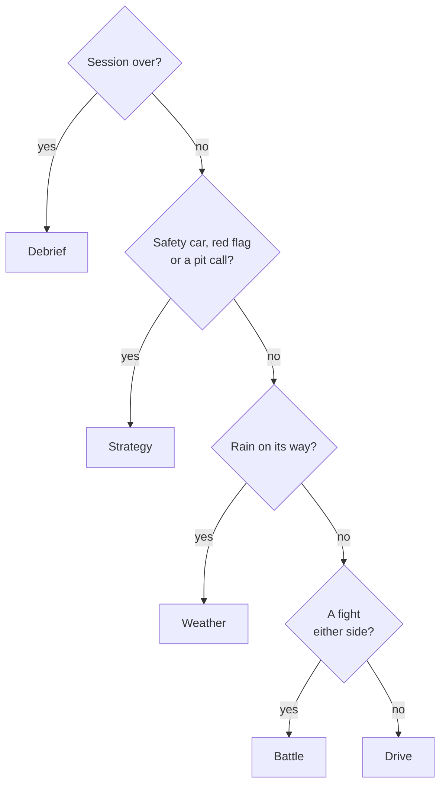

# The dashboard

[← Back to the README](../README.md)

**One rule: it doesn't repeat what the game already shows.** Tyre wear %, temperatures, fuel, the
timing tower and the delta are all on the game's HUD. The dashboard shows what the game *can't* tell
you, laid out so you can read it in half a second. The **Voice** button reads the calls out so you
don't have to look at all.

## The screens

Switch with the buttons down the left edge, or keys **1–6**.

| Screen | What it shows |
|---|---|
| **Drive** | The one to leave up. The **PUSH / HOLD / BOX** call and why; ATTACK / DEFEND / CLOSE IN; the car ahead and behind (gap, trend, chance of a pass, battery at the line, Overtake mode); the latest radio message; and four projections: laps to the tyre cliff, where you'd rejoin if you boxed now, weather in laps, and what damage costs. In practice and qualifying it switches to a lap view: where this lap would put you, the knockout line, time left and traffic. |
| **Battle** | The fight either side, big enough to read from the seat: gaps, closing rates, chance of a pass, each car's battery now and at the line, and top speeds. |
| **Strategy** | "Should I box?" Where you'd rejoin and next to whom, **pit timing** (which lap to box on), the stay-out and box options under a safety car, the **race plan** on the grid, the tyre model and the weather. |
| **Weather** | The forecast in laps, big, with tyre life and where a stop would put you. |
| **Custom** | Your own layout from the same widgets (battle, radio, call, rejoin, pit timing, tyres, setup tips, weather, pace, lap delta). |
| **Debrief** | After the race: the official result, best and theoretical-best lap, sectors against the fastest car, a lap chart and a position chart for the whole field. **Lap compare** puts two laps (or your lap and a rival's best) side by side as speed, throttle and brake traces, with corner-by-corner reasons. **Rivals** shows where you lose time to the fastest car. **Models** shows what the machine learning has learned and whether it beats the simple guess. |

### Auto-switch

Turn it on under **Settings** and the screen follows the race. It's decided on the PC, so every device
agrees.

A new screen stays up for at least 8 seconds, so it doesn't flicker, and the left rail says why it
switched. Picking a screen yourself pauses auto-switch for 30 seconds.

## Voice

**Ask:** tap **Ask** (or press **Q**, or map a wheel button to it) and ask a question. The answer is
spoken and shown, worked out on the device from the live data. The browser turns your speech into text,
and most browsers send the audio to their own servers to do it (Chrome sends it to Google), so it only
listens after you tap. The one-tap question buttons send nothing anywhere.

**Hands-free (Settings):** it listens all the time and only answers what starts with "Engineer", like
*"Engineer, gap behind?"*. Say just "Engineer" and it says "Go ahead" and waits. It's off by default
because, while it's on, the browser streams the microphone to its speech service. Use it on the PC with a
headset (`http://localhost:8080` counts as secure), or on a tablet with [https set up](setup.md#voice-on-a-phone-or-tablet).

| Say | It listens for | It tells you |
|---|---|---|
| "How bad is the damage?" | damage, wing, nose, floor | What's damaged, what it costs a lap and to the flag, and whether a new nose is worth a stop |
| "Any penalties?" | penalty, track limits, warnings | Penalties to serve, whether the gap behind covers a time penalty, your track-limit warnings |
| "Gap behind?" | behind, back, mirrors | Who's behind, the gap, and whether they're catching you |
| "Gap ahead?" | ahead, in front, gap | Who's ahead, the gap, and whether you're closing |
| "When do I box?" | box, pit, stop, undercut | The best lap to stop, the tyre, and where you'd rejoin and finish |
| "How are my tyres?" | tyres, wear, cliff | Tyre age and laps to the cliff |
| "Battery?" | battery, ERS, deploy, overtake | Your battery now and at the line, and the cars either side |
| "Is it going to rain?" | rain, weather, forecast | Rain in how many laps, or when it stops |
| "Fuel?" | fuel, gas | Fuel margin to the flag, and how much to save a lap if it's short |
| "Laps left?" | laps, left, position | Your position and laps to go (in qualifying: the gap to the cut or P1, and time left) |
| "What's the call?" | call, plan, strategy | PUSH / HOLD / BOX and why |

If a question matches two rows, the higher row wins ("gap behind" is about the car behind). Anything else
gets "Didn't catch that" and a list of what to try.

**Your own commands (Settings):** pick a phrase and tick what it should report, and the engineer reads it
all out at once. For example, *"status"* with gap ahead, gap behind, tyres and last lap. They show up as
buttons under **Ask** and are saved on that device.

## What it works out for you

**Strategy**
- **If you box now:** where you'd rejoin and who's around you. It uses the pit loss *measured from the
  other cars' stops this race*, and a per-track estimate until someone stops.
- **Pit timing:** every lap from now to the flag, raced out against the field. Your tyres wear at the rate
  learned from every car, rivals keep their own pace and make their own stops, and places lost at the
  rejoin count against you. It shows this lap, the next two and the best, and when the best lap is this
  one by a clear margin it becomes a **BOX** call. (At Monaco it picked lap 14 from three laps out; I
  actually stopped on lap 13.)
- **When rivals stop:** the AI stops at a share of its tyre set's rated life. At Monaco every car on
  mediums boxed at 12 laps on sets rated for 19-20. Once two stops have shown the wear the AI boxes at,
  each car is timed by its own wear instead.
- **The race plan, on the grid:** one stop or two, which tyres and when, from your own tyre sets and the
  wear rates measured in practice.
- **Under a safety car:** the call switches to HOLD, or BOX if the stop is cheap (a stop costs about 55%
  of normal under a safety car, 65% under a VSC).

**The fight**
- **Gap trends:** each car's clean-lap pace turns gaps into "closing 0.5s/lap".
- **Radio calls:** the tyre cliff, fuel margin ("0.4 laps short, save ~3% a lap"), defending, an undercut
  on the car ahead (only when fresh tyres would gain more than the gap before they stop), a car either
  side about to box, and a cheap stop under a safety car.
- **Battery:** where each car's battery will be at the line, and Overtake mode to attack or defend.
- **Flags:** a yellow up to 800 m ahead is called by corner before you reach it; a blue flag names the car
  lapping you.

**Your car**
- **What damage costs:** your lap is split into 25 slices, and clean laps since the hit are compared
  with clean laps before it. That gives the time lost per lap, where on the lap it goes, and whether a
  new front wing pays for the stop.
- **Setup tips:** wheel slip is watched braking zone by braking zone. The same lockup or wheelspin on 2 of
  the last 3 laps becomes a suggestion: move brake bias, change the on-throttle diff, or use ERS differently.
- **Tyre temperatures:** compared with the same parts of the track on your earlier laps ("Rears ~10 °C
  hotter than early in the stint"), because the game's absolute temperatures swing too much to trust.
- **Penalties and track limits:** warnings named by corner, and whether the gap behind covers a time penalty.

**Weather and sessions**
- **Weather in laps, not minutes:** "Rain in ~5 laps (70%)", counted down between the game's 5-minute
  forecast updates. Once cars are on both tyres, it compares them on the same laps to call the switch,
  and it never calls slicks in the rain or inters on a dry track with no rain due.
- **Inters under a safety car:** with rain ~3 laps away it weighs the cheap stop against the laps you'd
  run on inters on a dry track first, and gives one number: "box for inters, ~5s better than stopping
  later". It assumes the safety car comes in at the end of this lap, the worst case for boxing.
- **Qualifying mode:** the call becomes PREP (out lap), PUSH (timed lap) or BOX (in lap). It knows the
  knockout line, how many runs fit in the time left, and who is in your way.
- **2026 rules:** Overtake mode replaces DRS, and ERS mode 3 is called Boost.

**Calm by design:** only things you can't see from the cockpit (a safety car, a red flag, tyres at the
cliff, fuel running short) take over the top of the screen. A who-and-where call has to hold for 5
seconds before it's said, and a message whose numbers change doesn't flicker.
