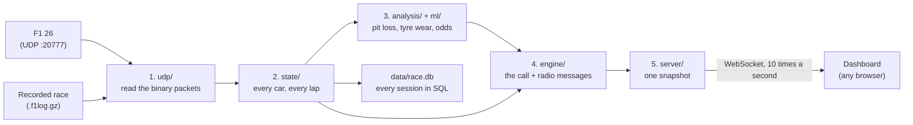

# How it's built

[← Back to the README](../README.md)

## The pipeline

Every packet goes through the same five steps, ten times a second. The live tool, the replays, the
dataset builder and the tests all use the same pipeline ([`src/pipeline.js`](../src/pipeline.js)), so the
demo can't drift from the real thing.



Each step only reads from the steps before it. [src/README.md](../src/README.md) maps every folder, and
[how-it-works.md](how-it-works.md) follows one call through the code.

## Decisions I made, and why

- **A small program on the PC, not a phone app.** Browsers can't listen for the game's UDP packets, and
  iOS restricts it for apps too. So a Node.js process next to the game takes the data, does all the work,
  and serves the result over a WebSocket. Any device just needs a browser, and that's also why the website
  demo is possible.
- **The whole field, not just your car.** The game already sends every car's laps, gaps and tyres, so
  tracking all of them costs almost nothing, and it's what makes pit timing and undercut calls possible.
- **Ten updates a second, whatever the game sends.** The game can send 60 a second; the dashboard doesn't
  need that, and it saves battery on the tablet. One update takes about 0.5 ms of CPU.
- **Game time, not the PC's clock.** Gaps and closing rates are measured on the game's own clock, so pausing
  doesn't break them, and a **flashback** rewinds everything recorded after it (otherwise you get laps 3, 4,
  3, 4…). Replays use the recording's clock, so a replay at 8× gives exactly the same calls as one at 1×.
- **Read the packets defensively.** F1 26 changed some packet layouts from F1 25, so each parser works out
  sizes from the packet's length instead of trusting the spec. A layout change logs a warning instead of
  crashing. Real F1 26 packets are stored in the tests.
- **The browser makes no decisions.** The dashboard only displays what it's sent, so there's one source of
  truth.

## Testing

I write each test from what the code *should* do and watch it fail before writing the code, and I never
edit a test just to make it pass. A test only counts once it catches a bug I plant on purpose.

- **Over 300 tests:** parsers on real F1 26 packets, random and corrupted packets (fuzzing), model
  properties, scripted race scenarios, the calls audit, every dashboard screen in jsdom, and a speed budget.
- **CI** runs them on every push on Linux and Windows (Node 20 and 22), fails if line coverage drops below
  88%, fails if a change makes the tyre model or rival-stop timing worse on the recorded races, and runs
  ESLint and the TypeScript check of the JSDoc types.
- What the tests have found so far is listed in the [roadmap](roadmap.md#what-the-tests-found).

## Commands

```bash
npm start                # the live tool
npm run demo             # replay the made-up demo race
npm run capture          # live, saving a full capture to captures/
npm test                 # all tests
npm run test:coverage    # tests with the coverage gate CI uses
npm run analyze          # check the newest capture, write report.md beside it
npm run accuracy         # score the predictions on every capture, writes docs/accuracy.md
npm run dataset          # rebuild datasets/ (races, laps, calls) from the captures
npm run backtest         # score the models on datasets/ and grade every call
npm run db               # fill the SQL race store (data/race.db) from the captures
npm run train:overtake   # retrain the overtake model from the captures
npm run lint             # ESLint
npm run typecheck        # TypeScript checks the JSDoc types in src/ and public/ (no build step)
npm run site             # build the demo website's data
npm run demo:regenerate  # rebuild the made-up demo race after changing src/sim/
node src/index.js --demo captures/<folder>/packets.f1log.gz --speed 8   # replay a real race at 8x
```

**Dependencies:** Node.js 20+ and three packages: `ws` (WebSocket), `qrcode-terminal` (the pairing QR
code) and `better-sqlite3` (the race store). `jsdom` and `c8` are for tests; `eslint` and `typescript` check the code (`npm run lint`, `npm run typecheck`: JSDoc types, no build step).

**Python (ml/ only, to retrain the overtake model):** LightGBM, scored against the gap-only baseline. It reads the samples
in `datasets/overtake-samples.csv.gz` (`npm run train:overtake -- --samples datasets/overtake-samples.csv.gz`
rebuilds them from the captures) and writes the report [ml-overtake-lightgbm.md](ml-overtake-lightgbm.md), the
trees the app runs (`src/ml/models/overtake-gbdt.json`) and the parity fixture `test/gbdt.test.js` checks:

```
python -m venv .venv && .venv/Scripts/pip install -r ml/requirements.txt   # bin/ instead of Scripts/ on macOS/Linux
.venv/Scripts/python ml/overtake_lgbm.py
```
