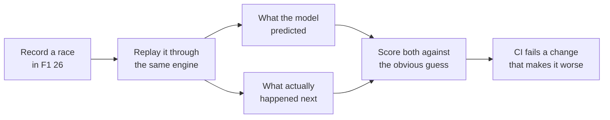

# Models and accuracy

[← Back to the README](../README.md)

Every prediction Undercut makes is checked against real races, next to the obvious guess it has to
beat. If a model doesn't beat the guess, the app says so.

## The results

From six races I recorded. Run `npm run accuracy` to regenerate the full report, [accuracy.md](accuracy.md).

| Prediction | Undercut | Obvious guess | Verdict |
|---|---|---|---|
| Tyre wear per lap, each car predicted from the others (1,264 laps) | 342 ms off | 485 ms ("no wear") | Beats it on 5 of 6 races |
| Where you rejoin after a stop (24 green-flag stops) | 2.54 places off | 4.33 ("keep your place") | Beats it, but it's too pessimistic |
| A rival's battery at the line (715 half-laps) | 7.7 points off | 13.2 ("stays where it is") | Beats it |
| When an AI car stops (23 green-flag stops) | 1.22 laps off | 1.24 (fixed share of tyre life) | No real gain yet |
| Will the car behind pass in 10 s? (held-out AUC) | 0.851 | 0.854 (gap only) | A tie, so it's marked experimental |
| Which corner they'll attack (33 passes) | 6 of 33 | 7 of 33 (busiest corner) | Not yet, so it says "likely spot" |

The rejoin model's error is nearly all one direction: it puts you about 2.5 places too far back. Fixing
that is next on the [roadmap](roadmap.md).

## The models

All of them are written from scratch (no ML library).

- **Tyre wear, learned from the whole field.** Every car's clean laps are compared with that car's own
  average, so fast and slow cars share one wear rate per compound, and the estimate firms up within a few
  laps instead of waiting for your own stint. Fuel burn is taken out using the measured burn rate. Each
  wear rate comes with a 90% range, from resampling the cars.
- **Will the car behind pass in the next 10 seconds?** A logistic regression over the gap, the closing
  rate, the pace difference, tyre age and compound, the battery difference and Overtake mode. It's trained
  on recorded races, using the game's own overtake events as the answers, and tested on races it never saw
  (`npm run train:overtake`, report in [ml-overtake-model.md](ml-overtake-model.md)). It ties the simple
  "just look at the gap" guess, so the dashboard treats it as experimental and caps it at about 50%.
- **Battery at the line.** Drivers spend their battery on the same straights every lap, so the rest of this
  lap is assumed to go like the same stretch of the last one.
- **Where they'll attack.** Your braking zones, ranked by where passes actually happen: the places *you've*
  been passed this race first, then the track's usual passing spots. It beats picking a corner at random
  (4.5 of 33), but not yet the simpler "busiest corner" rule.
- **The race plan.** One stop or two, raced 1,000 times with the wear rates and pit loss drawn from their
  uncertainty, which takes a few milliseconds. The card says something like "wins 87% of 1,000 simulated races".

## The calls audit

After each race, every PUSH / HOLD / BOX call is graded on the one thing it claims, using the laps that
came after it:

- **PUSH** claims the tyres will hold.
- **HOLD to manage tyres** claims the cliff is close.
- **BOX for damage** claims the time lost to the flag is worse than a stop.
- **BOX under a safety car** claims the stop is cheaper than one under green.

On the recorded races: **13 right, 0 wrong, 20 that the laps can't judge** (mostly a call replaced by a
safety car or a flashback before it could be checked). `npm run backtest` prints it.

## After the race

- **Lap compare** lines two laps up every 5 m, pairs up the braking zones, and explains each corner by brake
  point, apex speed and exit speed. On a real Suzuka race it found the 1.35 s I lost to contact after the
  hairpin, and that my hairpin brake point moved ±11 m from lap to lap.
- **Against a rival:** offline, the game sends every car's speed, throttle and brake, so each rival's best
  clean lap is traced too ("corner 8: braked 25 m earlier, 4 km/h slower at the apex" against Antonelli at
  Suzuka). Online, other cars' data may be hidden; that's untested.
- **Rivals:** every car is timed through 25 slices of the lap, to show where you lose time to the fastest car.
