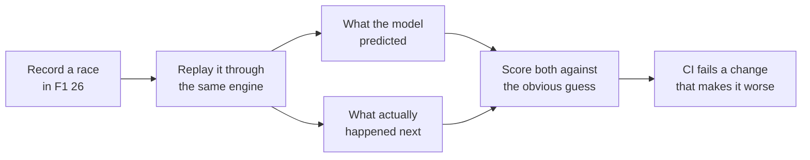

# Models and accuracy

[← Back to the README](../README.md)

Every prediction Undercut makes is checked against real races, next to the obvious guess it has to
beat. If a model doesn't beat the guess, the app says so.

## The results

From the 11 race sessions I recorded. Run `npm run accuracy` to regenerate the full report, [accuracy.md](accuracy.md).

| Prediction | Undercut | Obvious guess | Verdict |
|---|---|---|---|
| Tyre wear per lap, each car predicted from the others (1,893 laps) | 386 ms off | 492 ms ("no wear") | Beats it on 8 of 9 races |
| Where you rejoin after a stop (79 green-flag stops) | 3.13 places off | 6.37 ("keep your place") | Beats it; still 1.7 places pessimistic |
| A rival's battery at the line (1,278 half-laps) | 10.7 points off | 14.7 ("stays where it is") | Beats it |
| When an AI car stops (65 green-flag stops) | 1.31 laps off | 1.42 (fixed share of tyre life) | Beats it |
| Will the car behind pass in 10 s? (held-out AUC, 11 races) | 0.866 | 0.837 (gap only) | Beats it on all 11 races |
| Which corner they'll attack (75 passes) | 11 of 75 | 12 of 75 (busiest corner) | Not yet, so it says "likely spot" |

The rejoin model was 4.2 places off, nearly all of it too far back. It had assumed every other car stays
out, but AI cars stop in waves: on average 3 of the cars it put ahead were already in the pit lane, and
more were due that lap. Charging both their stop took it to 2.71 places on those first 45 stops; on all 79 it's 3.13, still about
1.7 places pessimistic ([roadmap](roadmap.md), M5).

## The models

All of them are written from scratch in JavaScript (no ML library), except the overtake model: LightGBM,
trained in Python (`ml/`) and run in the app from its exported trees (`src/ml/gbdt.js`).

- **Tyre wear, learned from the whole field.** Every car's clean laps are compared with that car's own
  average, so fast and slow cars share one wear rate per compound, and the estimate firms up within a few
  laps instead of waiting for your own stint. Fuel burn is taken out using the measured burn rate. Each
  wear rate comes with a 90% range, from resampling the cars.
- **Will the car behind pass in the next 10 seconds?** Gradient-boosted trees (LightGBM, 202 trees) over the
  gap, the closing rate, the pace difference, tyre age and compound, the battery difference and Overtake
  mode. Trained in Python (`ml/overtake_lgbm.py`) on 11 recorded races, using the game's own overtake events
  as the answers, and tested race by race on races each model never saw: AUC 0.866 against 0.837 for the gap
  alone, better on all 11 races, gain +0.021 to +0.035 (90% range over races). The app runs the exported
  trees in plain JavaScript (`src/ml/gbdt.js`; a test checks it matches Python to 1e-9). It is well
  calibrated up to 60%, so that's where the shown chance is capped. Report:
  [ml-overtake-lightgbm.md](ml-overtake-lightgbm.md). The logistic regression it replaced, written from
  scratch, tied the gap ([ml-overtake-model.md](ml-overtake-model.md)). On the six races that model never
  saw, "pass likely" now comes before 32% of the passes on you instead of 20%, and is right about as often
  (38% vs 41%).
- **Battery at the line.** Drivers spend their battery on the same straights every lap, so the rest of this
  lap is assumed to go like the same stretch of the last one.
- **Where they'll attack.** Your braking zones, ranked by where passes actually happen: the places *you've*
  been passed this race first, then the track's usual passing spots. It beats picking a corner at random
  (7.4 of 75), but not yet the simpler "busiest corner" rule (11 of 75 against 12).
- **The race plan.** One stop or two, raced 1,000 times with the wear rates and pit loss drawn from their
  uncertainty, which takes a few milliseconds. The card says something like "wins 87% of 1,000 simulated races".

## The calls audit

After each race, every PUSH / HOLD / BOX call is graded on the one thing it claims, using the laps that
came after it:

- **PUSH** claims the tyres will hold.
- **HOLD to manage tyres** claims the cliff is close.
- **BOX for damage** claims the time lost to the flag is worse than a stop.
- **BOX under a safety car** claims the stop is cheaper than one under green.
- **BOX for inters or slicks** claims that tyre is quicker: over the next 3 laps, the cars on it against the cars on the other one.

On the recorded races: **16 right, 0 wrong, 20 that the laps can't judge** (mostly a call replaced by a
safety car or a flashback before it could be checked). `npm run backtest` prints it.

## After the race

- **Lap compare** lines two laps up every 5 m, pairs up the braking zones, and explains each corner by brake
  point, apex speed and exit speed. On a real Suzuka race it found the 1.35 s I lost to contact after the
  hairpin, and that my hairpin brake point moved ±11 m from lap to lap.
- **Against a rival:** offline, the game sends every car's speed, throttle and brake, so each rival's best
  clean lap is traced too ("corner 8: braked 25 m earlier, 4 km/h slower at the apex" against Antonelli at
  Suzuka). Online, other cars' data may be hidden; that's untested.
- **Rivals:** every car is timed through 25 slices of the lap, to show where you lose time to the fastest car.
