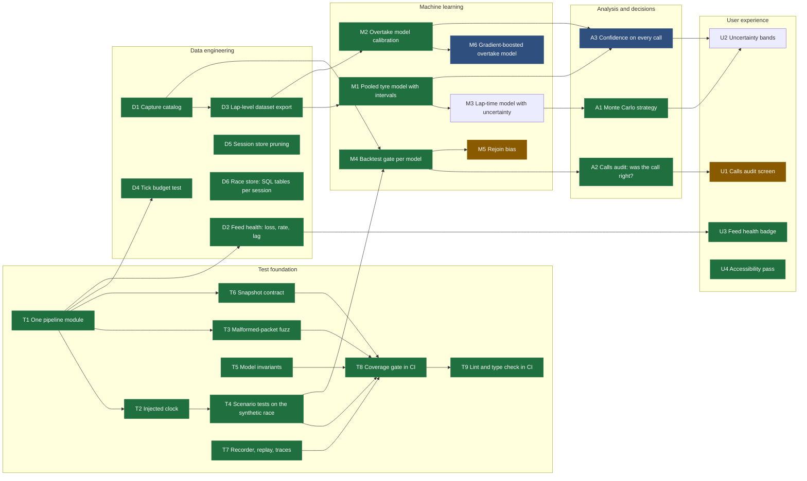

# Roadmap

The work plan as a dependency graph. Each node is one shippable change with a **test that defines
done**, written before the code it checks. A node is *ready* when every node it depends on is done.
Work loop: pick a ready node, write its tests from the acceptance line (they must fail first), make
them pass without editing the assertions, measure, mark it done here.

Green: done. Blue: partly done. Amber: ready next.

## Nodes

Each line: what it is, why it matters, and the acceptance test.

### Test foundation

- **T1 One pipeline module.** The engine was wired by hand in four places (live bridge, capture
  analyzer, demo builder, tests), so a fix in one could miss the others. `src/pipeline.js`
  builds field model → analysis → insights → focus → snapshot once.
  *Test:* `test/pipeline.test.js`: packets in, snapshot out, same as wiring it by hand.
- **T2 Injected clock.** Card expiries and settle timers read `Date.now()`, so replays and tests
  had to patch the global. The pipeline takes a `now()`; replays pass the capture's clock.
  *Test:* two replays of the same packets at different wall-clock speeds give identical calls.
- **T3 Malformed-packet fuzz.** The bridge listens on the LAN and trusts UDP bytes. Seeded random,
  truncated and bit-flipped packets go through the whole pipeline.
  *Test:* no exception escapes, every snapshot is valid JSON with finite numbers, and a clean
  session played afterwards gives the same snapshot as without the fuzz.
- **T4 Scenario tests.** The synthetic race scripts a tyre cliff, a rival stop, an attack from
  behind, a VSC and a shrinking fuel margin. *Test:* each scripted cause produces its call within
  a set time, and never before the cause.
- **T5 Model invariants.** Properties that must hold for any input, checked on many seeded random
  cases. *Test:* the rejoin position never improves with more pit loss and stays inside the field;
  AUC ignores monotone rescaling; the wear fit recovers a known slope through noise; rival stop
  estimates are never negative and never past the flag.
- **T6 Snapshot contract.** The dashboard reads about 100 snapshot fields; a rename on the server
  blanks a card without any error. *Test:* every field `public/` reads exists in a real snapshot.
- **T7 Recorder, replay, traces.** *Test:* record → replay gives back identical bytes in order;
  lap traces survive a flashback; mini-sectors add up to the lap time.
- **T8 Coverage gate.** *Test:* CI fails below the line coverage measured when this lands.
- **T9 Lint and type check.** *Done:* ESLint and TypeScript (checking JSDoc types in `src/`, no build
  step) run in CI beside the tests, which now run on Linux and Windows with Node 20 and 22. The decision
  engine's one 700-line function became one rule per topic (`src/engine/rules/`); every recorded race's
  report replays byte-identical, and 7 of 7 planted rule-order and shared-state bugs fail a test.

### Data engineering

- **D1 Capture catalog.** *Done:* [datasets/races.csv](../datasets/races.csv), one row per race
  session: track, laps run, cars, stops, neutralised laps, feed rate and loss.
- **D2 Feed health.** *Done.* Packet rate and loss over the last 10 s, from Car Telemetry's overall
  frame counter, measured against its usual step (1 frame at 60 Hz, 3 at 20 Hz) so the send rate
  isn't read as loss, and a pause isn't either. In the snapshot (`feed`) and the capture report.
  *Tests:* every 10th packet dropped reads 10%, random 5% averages 5%, a 30 s pause reads 0%.
  On the Suzuka capture: 51 packets a second, 0% lost (localhost).
- **D3 Lap-level dataset.** *Done:* [datasets/laps.csv](../datasets/laps.csv), 1,159 laps from 5
  races, no driver names, schema in [datasets/README.md](../datasets/README.md). Laps are recorded
  as they complete (the field model keeps only 12), taken back on a flashback, the flag lap kept.
- **D4 Tick budget.** *Test:* a full synthetic race keeps the mean engine tick under 2 ms.
- **D5 Session store pruning.** *Done.* The newest 50 debriefs are kept on disk; older ones are
  deleted when a session is saved. *Test:* 55 old files plus a new session leave the newest 50.
- **D6 Race store.** *Done:* every session as related SQLite tables (session, car, lap, stint,
  trace_point, event, engineer_call, radio_message, weather_sample) in `data/race.db`, filled live
  and by `npm run db`. Schema and examples in [race-store.md](race-store.md); the base for asking
  questions about a race in plain words. *Tests:* a replayed race stores the same laps as
  `laps.csv`, keys hold, a second write replaces, a flashback takes back what it undid.

### Machine learning

- **M1 Tyre model with intervals.** *Done:* each compound's wear rate comes with a 90% range, from
  refitting on the field resampled car by car (cars, not laps, are independent). On synthetic fields
  the range holds the true rate about 90% of the time and narrows with more cars. The engine refits
  only when a lap completes (~10 ms), not every tick. Pooling across races stays with the per-track
  memory: tracks wear tyres too differently to pool across them.
- **M2 Overtake calibration.** *Done:* Brier score, Brier skill and a held-out reliability table
  are in [ml-overtake-model.md](ml-overtake-model.md). It is well calibrated (20-40% predicted,
  33% observed) but doesn't beat the gap-only baseline yet.
- **M3 Lap-time model.** Fuel + tyre age + traffic, with residual spread, feeding A1.
- **M6 Gradient-boosted overtake model.** *Partly done:* LightGBM (Python, `ml/`) on the same samples from
  10 races, held out race by race: AUC 0.860 against 0.838 for the gap alone, better on 9 of 10 races, gain
  +0.014 to +0.030 (90% range over races). [Report](ml-overtake-lightgbm.md). *Test to finish:* the
  trees exported to JSON and run in the app give the same probabilities as Python, and the tick budget holds.
- **M5 Rejoin bias.** With 24 green-flag stops scored (3 before), the rejoin model is 2.54 places off
  and 2.46 of that is one direction: it puts the car too far back. *Test:* signed mean error under half
  a place on the recorded stops, without the absolute error getting worse.
- **M4 Backtest gate.** Every model scored per race in CI against its baseline; a change that makes
  a model worse than it was fails the build. *Done for the lap-level models:* the tyre model and
  rival-stop timing are scored on the committed dataset in CI against `datasets/scores.json`.
  Rejoin and battery need the packet stream, so they're still scored locally (`npm run accuracy`).

### Analysis and decisions

- **A1 Monte Carlo strategy.** *Done:* the grid plan raced 1,000 times with each wear rate and the
  pit loss drawn as widely as they're uncertain (a rate fitted this session by its 90% range, one
  remembered from earlier sessions by their spread, a default at ±40%). The card says "wins 87% of
  1,000 simulated races". Each plan's total is linear in the wear rates, so the search runs once and
  1,000 races take a few ms (5,800 plans pruned to 500 shapes). All three recorded races were short
  enough that one stop wins 100%; the tests cover the coin-flip case.
- **A2 Calls audit.** *Done:* each call is graded after the race by the one thing it claims, against
  the laps ([datasets/calls.csv](../datasets/calls.csv), `src/analysis/callsAudit.js`). PUSH: the tyres
  hold (no two green laps in a row 1.5 s off the pace before). Manage tyres: the cliff comes within 3
  laps. BOX for damage: the loss to the flag beats a stop. BOX under a safety car: the stop cost less
  than a green one (both measured against the cars that didn't stop). BOX for inters or slicks: the
  cars on that tyre are quicker over the next 3 laps. Following the rules isn't
  graded. On the 6 recorded races: 13 right, 0 wrong, 20 can't be judged (mostly a call replaced
  within its lap by a safety car or flashback). Pit-window and fuel calls aren't graded yet;
  nor is whether an offered undercut would have worked.
- **A3 Confidence on calls.** Every call carries how sure it is, from M1/M2 intervals. *Partly
  done:* the pit-timing pick is re-run at both ends of the wear range; when it moves, the card says
  "Lap 14–22, depending on tyre wear" (and nothing when it holds). On the recordings it moves a
  quarter of the time at Monaco, 5% at Barcelona. Still to do: the cliff warning and battle calls.

### User experience

- **U1 Calls audit screen** in the Debrief. **U2 Uncertainty bands** on rejoin and gap charts.
  **U3 Feed health badge** (*done*): the link chip says "Live · 8% lost" from 2% loss, and nothing
  extra when the feed is fine. **U4 Accessibility** (*done*): every text colour on every background at
  4.5:1 or more (dashboard and website), every control on every screen named for a screen reader,
  tabs that say which is selected, and a new call (PUSH → BOX) announced, not only drawn.

## What the tests found

Each of these was a failing test before it was a fix; none was found by reading the code.

| Test | Found | Fix |
|---|---|---|
| T3 fuzz | A packet with a NaN tyre-wear float stuck in the wear history; the wear rate read "null" for the rest of the stint. | A non-finite float marks the packet corrupt (none in 2.26M captured packets). |
| T5 invariants | The tyre fit's outlier trim applied indices from the fitted rows to the raw laps, so one car with too few laps on a compound shifted which laps were dropped. | Each row carries its lap. Held-out Monaco error 147 → 130 ms. |
| T5 invariants | Late-stint traffic (1-3 s, under the slow-lap filter) tilts the wear fit by up to 49 ms/lap on synthetic laps. | Not fixed: re-trimming fixed it there but predicted held-out cars worse on Suzuka. Kept as a `todo` test. |
| T4 scenarios | Damage read "front wing l 12%" on the radio, the voice answer and the card; an existing test asserted that text. | "front-left wing". |
| U4 accessibility | A new call (PUSH → BOX) was drawn but never announced to a screen reader; the voice-command phrase box had no label; the website's dim grey was 3.9:1. | A polite live region that speaks the call when the action changes (not its ticking numbers); a label; a lighter grey (5.1:1). |
| D4 budget | The tick-time budget failed in full test runs (p99 11 ms, later 29 ms against a 25 ms limit) even before any change: other test files run in parallel. | The mean is CPU time, which contention can't inflate. The p99 is wall-clock, fastest of three passes of the same deterministic replay (one tick's CPU time moves in ~15.6 ms steps on Windows, so it can't be used). A planted 3 ms stall fails it; three full runs in a row pass. Profiled on a 23-lap race: 0.58 ms a tick on average; the p99 (11.6 ms) is the tyre fit's 100-resample bootstrap, run whenever a car completes a lap, and is kept. |
| D1 catalog | The first lap dataset dropped every car's last lap: at the flag the lap counter doesn't move on. Seen as "4 of 5 laps" in the catalog. | Kept once the car has finished; a test for it. |
| D3 dataset | The tyre backtest in accuracy.md had scored only each race's last 12 laps (all the field model keeps). | Scored on every lap from the dataset: the model still beats "no wear" on 4 of 5 races (311 vs 417 ms a lap). |
| D6 race store | At the flag the game sends Session History with session UID 0. The field model reset on it, losing every car's final lap and the official result (no saved debrief had one; laps.csv was 120 laps short). | UID 0 belongs to the current session. Tyre backtest re-scored on the recovered laps: 342 ms (was 329 on fewer laps). |
| M4 backtest | Learning when the AI stops from the stops seen so far is biased early: the first stops a race sees are the early ones. In a field whose stops spread out it does worse than the prior (2.2 vs 1.5 laps off). | Not fixed; a `todo` test. With 23 green-flag AI stops now recorded (20 from one Barcelona race), learning scores 1.22 laps off against the prior's 1.24: no real gain yet. |
| A2 audit (Barcelona, 17 Oct) | The call flipped "undercut on" <-> "Tyres and fuel OK" 7 times in 3.5 minutes as the gap hovered. | A calm call holds 5 s before replacing another calm one (BOX, PIT, safety car: at once). 7 undercut calls -> 2. |
| A2 audit | The undercut said "box now, rejoin P21 in clean air" from P8, with no check that you'd come out ahead. | On only when fresh tyres gain more before they stop than the gap; says by how much. |
| A2 audit | ERS flipped Boost <-> "battery low, save it" every 10-20 s: the 2026 store swings 20%+ inside a lap. | Judged on the battery at the line. ERS radio 74 -> 46 a race. |
| A2 audit | "You gain 5.46s on the run to" corner 1: the pit lane runs over that stretch, and a pit lap was in the averaged splits. | Pit and neutralised laps left out; median, not mean. |
| A2 audit | Two defend cards took turns (battle call and under-attack): 45 of 55 key radio calls. | The battle call's DEFEND speaks on the one defend card. Key calls 1.4 -> 1.2 a minute. |
| A2 audit | The audit graded a PUSH wrong for laps slowed by wing damage. | Slow laps after a damage call on the same set can't judge the tyres. |
| T6 contract | (Mutation check) 5 of 5 snapshot field renames now fail a test; before, all 5 passed silently. | - |

Mutation checks - a test only counts once it fails on a planted bug:

- A2 fixes: 9 of 13 planted bugs caught at first; the 4 survivors (a pit-lap filter the median hid,
  attack judged on the live battery, a settle that never reset, the defend text ticking) each got a
  test, and are caught now.

- Model invariants: 6 of 8 planted bugs caught; the 2 survivors (a looser outlier trim, a break-even
  stop counted as worth it) each got the missing test, and are caught now.
- Dashboard contract: the first version (no "undefined"/"NaN" on screen) caught 0 of 5 field renames,
  because widgets show "–" for a missing field. Tracking every field a widget reads catches 5 of 5.
- Scenarios: 2 of 4 caught by the scenario tests, 3 of 4 by the whole suite. Not caught by anything:
  how long a card stays up (15 s vs 60 s) - no test pins card lifetimes yet.
