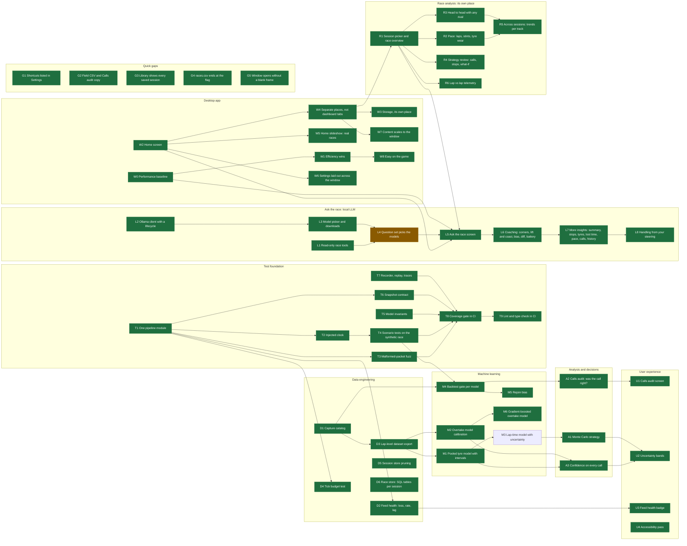

# Roadmap

The work plan as a dependency graph. Each node is one shippable change with a **test that defines
done**, written before the code it checks. A node is *ready* when every node it depends on is done.
Work loop: pick a ready node, write its tests from the acceptance line (they must fail first), make
them pass without editing the assertions, measure, mark it done here.

Green: done. Blue: partly done. Amber: ready next.

## Nodes

Each line: what it is, why it matters, and the acceptance test.

### Test foundation

- **T1 One pipeline module.** The engine was wired by hand in four places (live bridge, capture
  analyzer, demo builder, tests), so a fix in one could miss the others. `src/pipeline.js`
  builds field model → analysis → insights → focus → snapshot once.
  *Test:* `test/pipeline.test.js`: packets in, snapshot out, same as wiring it by hand.
- **T2 Injected clock.** Card expiries and settle timers read `Date.now()`, so replays and tests
  had to patch the global. The pipeline takes a `now()`; replays pass the capture's clock.
  *Test:* two replays of the same packets at different wall-clock speeds give identical calls.
- **T3 Malformed-packet fuzz.** The bridge listens on the LAN and trusts UDP bytes. Seeded random,
  truncated and bit-flipped packets go through the whole pipeline.
  *Test:* no exception escapes, every snapshot is valid JSON with finite numbers, and a clean
  session played afterwards gives the same snapshot as without the fuzz.
- **T4 Scenario tests.** The synthetic race scripts a tyre cliff, a rival stop, an attack from
  behind, a VSC and a shrinking fuel margin. *Test:* each scripted cause produces its call within
  a set time, and never before the cause.
- **T5 Model invariants.** Properties that must hold for any input, checked on many seeded random
  cases. *Test:* the rejoin position never improves with more pit loss and stays inside the field;
  AUC ignores monotone rescaling; the wear fit recovers a known slope through noise; rival stop
  estimates are never negative and never past the flag.
- **T6 Snapshot contract.** The dashboard reads about 100 snapshot fields; a rename on the server
  blanks a card without any error. *Test:* every field `public/` reads exists in a real snapshot.
- **T7 Recorder, replay, traces.** *Test:* record → replay gives back identical bytes in order;
  lap traces survive a flashback; mini-sectors add up to the lap time.
- **T8 Coverage gate.** *Test:* CI fails below the line coverage measured when this lands.
- **T9 Lint and type check.** *Done:* ESLint and TypeScript (checking JSDoc types in `src/` and the dashboard, no build
  step) run in CI beside the tests, which now run on Linux and Windows with Node 22, 24 and 26. The decision
  engine's one 700-line function became one rule per topic (`src/engine/rules/`); every recorded race's
  report replays byte-identical, and 7 of 7 planted rule-order and shared-state bugs fail a test.

### Data engineering

- **D1 Capture catalog.** *Done:* [datasets/races.csv](../datasets/races.csv), one row per race
  session: track, laps run, cars, stops, neutralised laps, feed rate and loss.
- **D2 Feed health.** *Done.* Packet rate and loss over the last 10 s, from Car Telemetry's overall
  frame counter, measured against its usual step (1 frame at 60 Hz, 3 at 20 Hz) so the send rate
  isn't read as loss, and a pause isn't either. In the snapshot (`feed`) and the capture report.
  *Tests:* every 10th packet dropped reads 10%, random 5% averages 5%, a 30 s pause reads 0%.
  On the Suzuka capture: 51 packets a second, 0% lost (localhost).
- **D3 Lap-level dataset.** *Done:* [datasets/laps.csv](../datasets/laps.csv), 1,159 laps from 5
  races, no driver names, schema in [datasets/README.md](../datasets/README.md). Laps are recorded
  as they complete (the field model keeps only 12), taken back on a flashback, the flag lap kept.
- **D4 Tick budget.** *Test:* a full synthetic race keeps the mean engine tick under 2 ms.
- **D5 Session store pruning.** *Done.* The newest 50 debriefs are kept on disk; older ones are
  deleted when a session is saved. *Test:* 55 old files plus a new session leave the newest 50.
- **D6 Race store.** *Done:* every session as related SQLite tables (session, car, lap, stint,
  trace_point, event, engineer_call, radio_message, weather_sample) in `data/race.db`, filled live
  and by `npm run db`. Schema and examples in [race-store.md](race-store.md); the base for asking
  questions about a race in plain words. *Tests:* a replayed race stores the same laps as
  `laps.csv`, keys hold, a second write replaces, a flashback takes back what it undid.

### Machine learning

- **M1 Tyre model with intervals.** *Done:* each compound's wear rate comes with a 90% range, from
  refitting on the field resampled car by car (cars, not laps, are independent). On synthetic fields
  the range holds the true rate about 90% of the time and narrows with more cars. The engine refits
  only when a lap completes (~10 ms), not every tick. Pooling across races stays with the per-track
  memory: tracks wear tyres too differently to pool across them.
- **M2 Overtake calibration.** *Done:* Brier score, Brier skill and a held-out reliability table
  are in [ml-overtake-model.md](ml-overtake-model.md). It is well calibrated (20-40% predicted,
  33% observed) but doesn't beat the gap-only baseline yet.
- **M3 Lap-time model.** Fuel + tyre age + traffic, with residual spread, feeding A1.
- **M6 Gradient-boosted overtake model.** *Done:* LightGBM (Python, `ml/`) on the same samples from
  11 races, held out race by race: AUC 0.866 against 0.837 for the gap alone, better on all 11 races, gain
  +0.021 to +0.035 (90% range over races). [Report](ml-overtake-lightgbm.md). The app runs the exported trees
  (`src/ml/gbdt.js`): JS matches Python to 1e-9 on 200 real samples. On the 6 races the logistic model it
  replaced never saw, "pass likely" now comes before 32% of passes instead of 20%, right 38% of the time
  (was 41%). Calibrated to 60%, so the shown chance is capped there (was 50%).
- **M5 Rejoin bias.** With 45 green-flag stops scored, the rejoin model was 4.22 places off and 4.18 of
  that one direction: too far back. *Test:* signed mean error under half a place on the recorded stops,
  without the absolute error getting worse. *Partly done:* the cause wasn't the pit loss (measured 20.5 s,
  really 21.6 s by 25 s after the stop) but the "everyone else stays out" assumption: in AI pit waves ~3
  of the cars it put ahead were already in the pit lane (the game reads their gap as 0, so they kept the
  time of the car ahead on the road). Charging those, and the cars the rival-stop model has due this
  lap: 2.71 places off, 1.47 pessimistic. Due within one lap instead got the bias to 0.53 but the error
  up to 3.24, so this lap it is. On all 79 stops recorded since: 3.13 places off, 1.66 pessimistic.
  *Done (4 Nov 2026):* the score is taken 25 s after the stop, when the out-lap has hardly begun, so about a
  quarter of the stop's loss is still to come. Sweeping the share charged (to the player and to the cars due to
  stop alike; charging only the player's was worse, 3.30 off), three quarters gives 0.11 places pessimistic with
  the error down to 2.80 on the 79 stops, the target met (`REJOIN_LOSS_SHARE`, `test/rejoinShare.test.js`).
  Held out race by race (the share chosen on the other races each time): 0.54 and 2.90, so most of the gain is
  real; single races still run from 3.5 places optimistic to 3 pessimistic. A rival-stop probability instead of
  yes-or-no was tried and made the error worse (3.1 to 3.5). Pit timing models its own rejoin and isn't scored,
  so its "box now" place can differ from this card by a place; unifying them is open.
- **M4 Backtest gate.** Every model scored per race in CI against its baseline; a change that makes
  a model worse than it was fails the build. *Done for the lap-level models:* the tyre model and
  rival-stop timing are scored on the committed dataset in CI against `datasets/scores.json`.
  Rejoin and battery need the packet stream, so they're still scored locally (`npm run accuracy`).

### Analysis and decisions

- **A1 Monte Carlo strategy.** *Done:* the grid plan raced 1,000 times with each wear rate and the
  pit loss drawn as widely as they're uncertain (a rate fitted this session by its 90% range, one
  remembered from earlier sessions by their spread, a default at ±40%). The card says "wins 87% of
  1,000 simulated races". Each plan's total is linear in the wear rates, so the search runs once and
  1,000 races take a few ms (5,800 plans pruned to 500 shapes). All three recorded races were short
  enough that one stop wins 100%; the tests cover the coin-flip case.
- **A2 Calls audit.** *Done:* each call is graded after the race by the one thing it claims, against
  the laps ([datasets/calls.csv](../datasets/calls.csv), `src/analysis/callsAudit.js`). PUSH: the tyres
  hold (no two green laps in a row 1.5 s off the pace before). Manage tyres: the cliff comes within 3
  laps. BOX for damage: the loss to the flag beats a stop. BOX under a safety car: the stop cost less
  than a green one (both measured against the cars that didn't stop). BOX for inters or slicks: the
  cars on that tyre are quicker over the next 3 laps. Following the rules isn't
  graded. On the 9 recorded races: 16 right, 0 wrong, 20 can't be judged (mostly a call replaced
  within its lap by a safety car or flashback). Pit-window and fuel calls aren't graded yet;
  nor is whether an offered undercut would have worked.
- **A3 Confidence on calls.** Every call carries how sure it is, from M1/M2 intervals. *Partly
  done:* the pit-timing pick is re-run at both ends of the wear range; when it moves, the card says
  "Lap 14–22, depending on tyre wear" (and nothing when it holds). On the recordings it moves a
  quarter of the time at Monaco, 5% at Barcelona. The cliff warning too (3 Nov 2026): when the last
  laps' wear steps disagree it says "~1–2 laps to the cliff, depending on how the wear goes"
  (`test/state.test.js`). *Done (4 Nov 2026):* the battle calls. The overtake model's two noisy inputs
  (how fast the gap is closing, the pace difference) are each moved by 1.28 standard errors, read from the scatter
  of the gap samples and of the last clean laps, and the model re-run (`src/ml/passRange.js`,
  `featureSpread`): the chance carries a range ("28% (18-41%)" on the Battle card). The call words it when the range
  crosses a level ("pass chance low to high") and marks it soft; sandwiched between two overlapping ranges it is a
  toss-up (`test/passConfidence.test.js`). The range is what the inputs allow, not a coverage figure for the
  model: a pass either happens or not, so it can't be checked against single outcomes; the model's own
  calibration is in [ml-overtake-lightgbm.md](ml-overtake-lightgbm.md).

### User experience

- **U1 Calls audit screen** (*done*): the Debrief's Calls tab grades each race call (right, wrong,
  unclear, or following the rules) with what happened, as `npm run backtest` does, and keeps it with the
  saved session. **U2 Uncertainty bands** (*done*, 4 Nov 2026): the rejoin card shows the places a stop that ran
  short or long would give (pips; the scatter of the measured stops); Race analysis, Head to head, draws the
  typical lap difference and the range it could be behind the bars, and says "too close to call" when the range
  holds zero; Ask the race's gap chart fits the longest run of laps with nobody stopping and draws the trend and its
  range ("you lost 0.31 s a lap to LECLERC over laps 12-21, 80% sure between 0.22 and 0.40"), and tyre pace by stint
  does the same per stint. One shared file, `public/spread.js`, and each band is tested for coverage: on many noisy
  samples around a known truth the 80% band holds it 75-85% of the time (`test/spread.test.js`).
  **U3 Feed health badge** (*done*): the link chip says "Live · 8% lost" from 2% loss, and nothing
  extra when the feed is fine. **U4 Accessibility** (*done*): every text colour on every background at
  4.5:1 or more (dashboard and website), every control on every screen named for a screen reader,
  tabs that say which is selected, and a new call (PUSH → BOX) announced, not only drawn.

### Desktop app

The app runs on the same PC as F1 26, so it must cost the game nothing: every node here is measured
against W0, and none may raise the race numbers.

- **W0 Performance baseline.** A script (`scripts/perf-app.js`) drives the installed app with the
  synthetic session at 60 Hz and samples every Undercut process (main, window, GPU): CPU %, RAM, and
  the same while idle (minimized, no game). Also startup time to a usable Home and installed size.
  *Test:* the script prints one table; the numbers go in `docs/performance.md`; a second run lands
  within 10% of the first. *Done:* [performance.md](performance.md). Idle 0.6-2% of one core, a race
  7-10% with the dashboard showing and 3-5% minimized, ~350-400 MB, 0.8 s to Home. Idle repeats;
  race phases vary ~20% run to run (Windows scheduling), so changes are compared over several runs.
- **W1 Efficiency wins.** Cache `orderedByPosition()` once per Lap Data packet; skip the drawing steps
  of `render()` while the window is hidden (the voice keeps speaking); load a desktop screen's data
  only when it's opened; check Electron's `backgroundThrottling` and the snapshot size.
  *Test:* `test/perf.test.js` stays green; a hidden page runs no widget update but still voices a
  call; W0 re-run shows race and idle CPU no higher, idle lower. *Done (partly as planned):* the
  hidden page draws nothing and still speaks (`test/app.test.js`); W0 re-run: no measurable change
  minimized (the engine, not drawing, is what is left). The running-order cache was dropped: see
  performance.md. Desktop screens already load their data only when opened (places, W4).
- **W2 Home screen.** A real landing page that fills the window: a race-themed background image
  (our own or a free-licence photo; no F1 logos, team liveries or trademarks) and big tiles: Live
  dashboard, Race analysis (Debrief), Ask the race (LLM), Storage, Connect / record, Settings. One
  line of state per tile at most. The rail appears only inside the dashboard, with a way back Home;
  the rail stops scrolling at 860 px. Built with the taste skill. *Test:* Home renders with no rail,
  every tile routes to its screen and back; no horizontal scroll; screenshots at 1440x900 and
  1100x760 checked; W0's idle number unchanged with Home open. *Done:* `test/desktopHome.test.js`;
  a photograph behind the name (now the W5 slideshow); the rail
  lists the race screens only (Connect and Storage join it while open) and fits at 860 px; Home idles
  at 1.9% of one core, as before. Ask the race is shown disabled until L5.
- **W5 Home photo.** The user asked for real F1 cars racing wheel to wheel, modern and famous, in
  place of the Singapore skyline. Options (licences checked) are in `notes/home-photo-options/`
  (batch3 is the modern set; A, Hamilton vs Verstappen at Austin 2021, CC BY 2.0, is the lead).
  *Test:* the credit on Home matches the photo's Commons page; the cars stay clear of the bars at
  1440x900 and 1100x760 (screenshots). *Done:* the user chose a slideshow of three: Verstappen vs
  Leclerc (Austria 2023), Leclerc at Zandvoort 2024, Leclerc holding off Hamilton (Monza 2019), each
  credited while it shows. A new one every 8 s with a 0.7 s crossfade under a flat dark layer (a CSS
  filter repainted every frame: 6-7% of a core); it waits while the window is hidden and stops when
  Home is left. Home idle 4.2% of one core against 1.9% with a still photo; minimized unchanged.
- **W4 Separate places, not dashboard tabs.** A Home destination opens a place of its own that fills
  the window, with its own navigation and a way back to Home, never a tab inside the dashboard:
  Live dashboard is the dashboard (rail and all); Race analysis, Storage, Ask the race and Connect
  each have their own layout. The dashboard rail stays race-only. *Test:* each destination except
  Live dashboard opens with no dashboard rail and its own back-to-Home; the dashboard rail lists
  only race screens; Back/Esc returns to Home; nothing mounted in a place keeps running after
  leaving it (W0 idle unchanged). *Done:* `test/desktopHome.test.js`. Race analysis, Storage and
  Connect open as places (Race analysis shows the Debrief until R1); the rail is Home + the six race
  screens; Esc and ← Home return; auto-switch never pulls you out of Home or a place.
- **W6 Settings laid out across the window.** The user (3 Nov): Settings opened from Home should
  read horizontally, not as one tall column. In the app, Settings uses the window's width (groups
  side by side: this PC, voice, auto-switch, devices) instead of a narrow sheet you scroll down.
  *Test:* at 1440x900 every setting is visible without scrolling; at 1100x760 at most one scroll;
  every control keeps its label; phones and browsers keep today's sheet. *Done:* three columns
  (on/off settings, voice commands, this PC), each its own stack; no scroll at 1100x760.
- **W7 Content scales to the window.** The user (3 Nov): on a big screen the content sat in a column
  and didn't scale. The screens are laid out for 1440 x 900; any other window zooms the whole page by
  the smaller of its width and height ratios, between 80% and 175%, and places use the full width.
  *Test:* `test/zoom.test.js` (1920x1080 -> 120%, 2560x1440 -> 160%, floors and ceilings, resizing
  back). *Done* (desktop/preload.js), checked by screenshots at 1100x760, 1920x1080 and the user's
  3440x1440 ultrawide. Ask the race then moved its session and model pickers onto the title's row so
  the empty chat sits in the middle of the window.
- **W3 Storage, its own place.** Built on W4, replacing the Library tab. Disk use per store (race.db, debriefs, captures, downloaded models) with
  delete, using the existing `deleteSession()`. *Test:* the sizes shown add up to the folder size on
  disk; deleting a session leaves no store mentioning its uid; deleting a model frees its bytes. *Done
  (but models, which come with L3):* `diskUse` in desktop/library.js (`test/desktopLibrary.test.js`) and
  Storage's rows per store, largest first, refreshed after each delete (`test/desktopHome.test.js`).

### Ask the race: local LLM

The model never runs while you race. The engine computes every number; the model only picks tools and
phrases the answer.

- **L1 Read-only race tools.** `sessions`, `lap_times`, `compare_laps`, `stints`, `gaps`, `calls`,
  `events` over race.db and the debrief, each with a JSON schema; a read-only connection.
  *Test:* each tool on a fixture session returns the known laps; a write through the connection
  fails; no tool takes free SQL. *Done:* `src/llm/tools.js` (`test/llmTools.test.js`): seven tools, arguments checked
  against each schema before any query, compare_laps reusing lapCompare on the stored traces.
- **L2 Ollama client with a lifecycle.** Talks to Ollama on `127.0.0.1:11434` (detect it, link to
  the installer if missing). Every request sends `keep_alive: 0`, so the model leaves memory as soon
  as the answer is done; a live session start sends an unload and blocks new requests until it ends;
  a Stop button cancels a running answer. *Test:* against a fake Ollama server: every request carries
  `keep_alive: 0`; a request during a live session is refused without reaching the server; a session
  start unloads a loaded model; after an answer `/api/ps` lists nothing. *Done:* `src/llm/ollama.js`
  (`test/ollama.test.js`, the bridge's `live()` and `onSessionStart` in `test/start.test.js`), in the app's main
  process only, so phones on the Wi-Fi can't reach it. One change from the plan: within one answer the
  tool rounds keep the model warm for a minute (`keep_alive: "1m"`), so it doesn't reload from disk for
  every tool call, and every answer ends with `keep_alive: 0`, whether it finished, failed or was stopped.
  Decided 3 Nov 2026: you install Ollama yourself (the app links to it). Setting it up from inside the
  app (its standalone build, started only when asked) was weighed and left out for now.
- **L3 Model picker and downloads.** A short list of small models that fit a 4 GB GPU (to start:
  Qwen3 1.7B and 4B, Llama 3.2 3B, Gemma 3 4B, Phi-4-mini), each with download size and licence,
  pulled through Ollama with progress, and deletable. The list is trimmed by L4's scores.
  *Test:* pull progress reaches 100% on the fake server; a cancelled pull leaves nothing listed;
  delete removes the model; licences shown match the model cards. *Done:* the Ask the race place
  (`public/askrace.js`, `test/desktopAskRace.test.js`): the not-while-racing notice, Get Ollama when it is
  missing, and the models from `src/llm/catalog.js` with size, licence, download progress, cancel and
  delete; downloads refused while the game sends telemetry (`test/ollama.test.js`). Gemma 3 left out: no
  tool calling in Ollama. Since: Storage shows the models' disk use (a row from Ollama), and real Ollama confirmed qwen3:1.7b at 1.36 GB and qwen3:4b downloading and answering.
- **L4 Question set picks the models.** 20-40 questions from the recorded races with expected facts
  ("where did I lose time on lap 21?", "was the lap 12 box call right?"). *Test:* `npm run llm-eval`
  scores each model (facts right, laps cited, refuses what the data doesn't show) and time per
  answer on this PC; the scores go in `docs/accuracy.md`; models under the bar leave the list. *Started:* `npm run llm-eval`: questions
  whose answers come from race.db (best lap, start and finish, winner, position on a lap, the stop and its
  tyres, who finished behind, where time went on a lap, and one the data can't answer). qwen3:1.7b, 3 Nov
  2026: 31/31 right and grounded on four races, 8-10 s a question on a GTX 1650. With coaching (L6) and the
  re-processed races: 45/46 right, 46/46 grounded. The scores live in docs/ask-the-race.md (accuracy.md is
  generated by `npm run accuracy`). 3 Nov 2026, clean run with a
  "no" question and drivers and tyres checked: Qwen3 4B 49/50 right (one timeout), 60-65 s a question;
  Qwen3 1.7B 48/50, 8-10 s (it flipped the "no"). Scoring 4B found an engine bug ("where did I finish"
  got coaching), fixed. Still to do: Llama 3.2 3B and Phi-4-mini, and more questions with a "no" answer.
- **L5 Ask the race screen.** Its own place (W4), reached from Home and from Race analysis (R1). A clear notice: "Not for use
  while racing - it uses the GPU the game needs"; the input is disabled while a session is live.
  Answers cite laps or say the recording doesn't show it. A post-race summary only on request.
  *Test:* the input is disabled and the notice shown while live; a W0 run with the screen open but
  unused shows no model loaded and no extra CPU; every answer in L4's set cites a lap or refuses. *Done:* `public/askrace.js` (`test/desktopAskRace.test.js`)
  and `src/llm/ask.js`: a session and model picker, the question box with Stop, suggested questions, and
  the answers newest first, each with its chart, a warning for anything not in your data, and "How this was
  worked out". The engine gives the model a brief of the session (every lap with its gap to your best,
  stops with their tyres, overtakes, calls), looks up what the question is about itself (a lap comparison
  in sentences, the order on a lap, a named driver), and checks every lap time, lap, position and seconds
  figure in the answer. Charts (`src/llm/charts.js`, `test/llmCharts.test.js`): lap times, positions, gap to
  a driver and two laps' speed, drawn by the engine with a one-line finding; the engine attaches one when
  the question is about it, the model can ask for one (`show_chart`), and the chart buttons draw them with
  no model at all.

- **L6 Coaching.** Asked "where did I lose time through the lap, what can I do better, what about brake
  bias, the differential, the battery, lift and coast" (3 Nov 2026). The engine's rules give the advice,
  each with the number it rests on; the model explains it. *Done:* corner by corner against your best
  lap (brake point, apex speed, full throttle after the apex, coasting; `lapCompare`, `lapCorners`,
  `src/llm/coaching.js`); lift and coast (the braking zones after the longest flat-out runs, fuel a
  lap); brake bias and differential from what the car did at each corner (locks, wheelspin, understeer,
  now kept in race.db's `corner_issue` with the settings at the time, and `car_setting`), with the
  live suggestions' rules; the battery (charge and deploy mode now in every telemetry point) with where
  it was used and charged, the low point, and rules for empty, unused and misplaced deployment.
  `npm run db -- --db <file>` re-processes recordings into the app's store so past races get it too.
  *Test:* `test/lapCoaching.test.js`, `test/coaching.test.js`, `test/store.test.js`,
  `test/llmTools.test.js`, `test/llmAsk.test.js`; qwen3:1.7b answered the coaching and lift-and-coast
  questions right on all four races. Still open: the thresholds are first guesses, and setup advice is
  rules of thumb, not an optimiser.
- **W8 Easy on the game.** The user (4 Nov 2026, after a new race): frames dropped in F1 26 with Undercut
  running. Measured: the app's GPU use is ~0 (GPU engine counters, `scripts/perf-app.js`), about 1% of the PC's
  CPU, recording's gzip ~2.6% of one core. Whether it cost frames is unproven (the new race's telemetry arrived at
  41.7/s against ~50/s earlier but with fewer hitches; `npm run cadence` prints this for any capture). Done anyway:
  a Settings switch, on by default, that runs the app's processes at below-normal priority (`desktop/priority.js`,
  reapplied every 10 s) and redraws the in-app dashboard at 4 Hz instead of every snapshot (race dashboard
  14.5% -> 10.1% of one core). *Test:* `test/easyOnGame.test.js`, `test/cadence.test.js`. *Open:* record the same
  track with Undercut minimized and open and compare `npm run cadence`.
- **L8 Handling from your steering.** The user (4 Nov 2026): use the steering data to detect oversteer and
  understeer and suggest setup and differential changes. `src/llm/steering.js` reads each racing lap's steering,
  speed and pedals against your own median at every corner: extra apex lock with less speed is understeer; extra
  countersteer after the apex is oversteer, split on or off the throttle; only what repeats (2+ laps, 25%) is
  called the car, the rest are one-offs. Wheel-slip rows are cited when they agree. Advice is only what the
  community guides agree on (front/rear wing, off-throttle diff, a gentler throttle, brake bias if a rear lock
  coincides), hedged, with your current setting; the on-throttle diff direction is told as "test each way"
  because guides contradict. Tool `steering_balance`, insight button "Handling", routing for understeer /
  oversteer / steering / handling words. It reads steering, not yaw, and needs 5+ traced laps. *Test:*
  `test/steering.test.js`, routing in `test/llmInsightTools.test.js`. *Open:* the older `car_balance` rule
  was reconciled with the guides (4 Nov): wheelspin raises the on-throttle diff, understeer lowers it. Not done: a steering chart.
- **L7 More insights.** The user (4 Nov 2026): let Ask the race do more and give more insights. Seven
  lookups the engine works out whole from race.db and hands the model as sentences (`src/llm/insights.js`; the
  model words, never computes): `race_summary` (the race in points), `pit_stops` (each stop priced against the
  cars that didn't stop and the field's green-flag stops, places before and after), `tyres` (each stint's clean
  laps, average, best and whether the pace got slower or quicker over it, with its range), `lap_losses`
  (consistency, and the laps 0.7 s or more off typical with what was recorded on each: collisions, penalties,
  passes, an invalid lap, locking), `field_pace` (every car's typical clean lap ranked, you among them, the
  fastest lap), `calls_review` (the calls audit's verdict and each call) and `track_history` (your races at the
  track over time). Questions are routed by the engine (`lookups`), a tyre-pace-by-stint chart with each stint's
  trend and range, new suggested questions. *Test:* `test/llmInsights.test.js` (hand-built races whose answers are
  worked out), `test/llmSummary.test.js`, `test/llmInsightTools.test.js` (the tools over a recorded session,
  the routing of 25 questions, the model's prompt), `test/llmStintChart.test.js`, `test/desktopAskRace.test.js`.
  `npm run llm-eval` gained a question for each, answered from the same results. Qwen3 1.7B on the 70-question
  set over four races: 61 right, 70 of 70 grounded; the new-question misses are the small model's judgement
  (a slowing stint "held up well"), not its numbers. *Open:* score Qwen3 4B on the expanded set.

### Race analysis: its own place

The Debrief is a dashboard card sized for a tablet mid-session. Race analysis is the in-depth
version, a place of its own on the PC (W4), built on the same saved sessions (debrief files and
race.db), with the data presented properly: large charts, tables you can sort, everything per
session and across sessions. Every chart is drawn from data the engine already saved; nothing is
estimated on the page. Use the taste skill and the dataviz skill for every view.

- **R1 Session picker and race overview.** Pick any saved session (track, type, date, result);
  the overview shows result and grid, best lap, stints as a strip, the safety cars and the key
  moments in order. *Test:* every saved session opens; the numbers match its debrief file.
  *Done:* `public/analysis.js`, `test/desktopAnalysis.test.js`: sessions down the left, the result in
  large type, six stats, stints to scale, positions lap by lap with a hover crosshair, key moments
  (start, penalties, stops, safety cars, best lap, finish) in lap order; Full debrief on the same
  session. Real data caught two bugs the fixture didn't: the place stayed blank with no game
  running, and a stop flagged on the in-lap and out-lap showed as two. The list is the 10 sessions
  the debrief keeps in memory (G3 covers the rest on disk).
- **R2 Pace.** Lap times through the race with in/out laps and neutralised laps marked, stint pace
  and tyre wear rate per stint, sector times, best and theoretical best. *Test:* on a recorded
  race the chart's points equal laps.csv for that session. *Done:* `test/desktopPace.test.js`: every
  lap on the chart (start, pit, safety car, invalid and best marked as such), per stint the typical and
  best lap, the pace change per lap and the wear per lap fitted on its clean laps, sectors best against
  typical, and every lap in a table sortable by any column with CSV. "Pace change" rather than "lost to
  wear": fuel burn speeds the car up over a stint, so the fit is the net of both.
- **R3 Head to head.** Pick any rival: the gap lap by lap, where the time went by corner on any
  lap pair (lapCompare), their stints next to yours. *Test:* the gap at each lap equals the
  debrief's gap; the corner deltas add up to the lap delta. *Done:* `test/desktopHeadToHead.test.js`,
  `/api/debrief/field` (`test/debrief.test.js`): every car's laps as the sum of its mini-sector splits
  (they add up exactly to the official lap times on the recorded races); against any car, the typical
  difference a lap over the laps you both ran cleanly (a lap 7% off a car's own typical is left out),
  each lap's difference, and where on the lap the time goes, slice by slice. Corner by corner against a
  rival's best lap is in Lap vs lap (R6).
- **R4 Strategy review.** Every call with its grade (calls audit), the pit stops and what they
  cost or gained, the rejoin predicted vs actual, and a what-if on the stop lap (A1). *Test:* the
  grades equal `npm run backtest` for the session. *Done (all but the what-if):* Race analysis, Strategy:
  the calls verdict in a sentence, every call in lap order filterable by grade (copy as text), each of
  your stops priced against the others' green-flag stops in the same race (the audit's `stopsOf`, now
  returned by `/api/debrief/audit`), all of them on one axis, and where you rejoined
  (`test/desktopStrategy.test.js`, `test/debriefAudit.test.js`). A race saved before the calls were kept
  with the session is graded from race.db instead (`src/data/storeAudit.js`, matched by session id or by
  track, type and start time; `test/storeAudit.test.js`): all six of your saved races. Predicted rejoin and the
  what-if on the stop lap are left: neither prediction is saved with the session yet.
- **R6 Lap vs lap telemetry.** Any of your laps against another, or against a rival's best: the time
  gap, speed, throttle, brake, gear and steering on one distance axis with one crosshair across them
  all, the verdict in a sentence, and the corners ranked by time lost (click one to zoom every
  chart to it). From the traces the app already saves (lapCompare). *Test:* the pickers map to the
  bridge's reference/explained laps; every channel has both laps; the corner zoom and the whole-lap
  reset hold the same range on every chart; a compare the bridge can't make says why.
  *Done:* `test/desktopLapCompare.test.js`; steering added to the comparison (`test/analysis.test.js`).
  The two laps' colours pass the dataviz palette checks on the dark ground (CVD ΔE 24).
- **R5 Across sessions.** Your pace per track over time, tyre wear learned per track, how often
  the calls were right. *Test:* adding a session moves only that track's numbers. *Done:* Race analysis,
  All races (`src/data/trends.js`, `/api/trends`; `test/trends.test.js`, `test/desktopAnalysis.test.js`): per track every race's
  best and typical lap in date order and the change from your first race, tyre wear a lap per track and tyre,
  and the calls graded race by race from race.db (20 of 39 right, none wrong, on your 10 races).
  Strategy grades old races' calls from race.db too (`src/data/storeAudit.js`).

### Quick gaps

Found reading the app on 3 Nov 2026; an hour or less each.

- **G1** Settings lists the keyboard shortcuts (1-8 screens, M mark, Q ask, Esc close). *Test:* every
  key with a handler appears in the list, and every listed key has a handler.
- **G2** Debrief: CSV of the Field table and a copy button for the Calls audit (same pattern as
  `lapsCsv`). *Test:* the CSV round-trips the table's rows; the copied text has every graded call. *Done:* `fieldCsv` and `callsText` in public/debrief.js (`test/ui.test.js`); the Calls view's "Copy as text" puts the summary and one line per call on the clipboard.
- **G3** Library shows every session on disk (50), not the 10 the debrief keeps in memory.
  *Test:* with 12 saved sessions the Library lists 12. *Done:* `/api/debrief/older` summarizes each
  session on disk past the 10 in memory once (cached by file) and opens one in full on demand; Storage
  and Race analysis list them after the newer ten (`test/debrief.test.js`, `test/desktopHome.test.js`,
  `test/desktopAnalysis.test.js`). The snapshot still carries 10, so the once-a-second debrief stays
  small. Found on the way: Storage's "Open in Race analysis" opened the newest session, not the one
  clicked; fixed. Full debrief is offered only for the 10 in memory (the card reads the snapshot).
- **G4** `races.csv` `durationMin` ends at the chequered flag, not the results screen. *Test:* a
  synthetic race with a 2-minute results screen reports its racing time only. *Done:* the Event packet's
  CHQF ends the race (`test/buildDataset.test.js`); races.csv rebuilt: Silverstone 15.3 to 8.7 min, Spa
  46.6 to 37.5. The rebuild also picks up the Red Bull Ring race (2026-10-19_153711) that laps.csv never
  had. Added 3 Nov 2026 with the gate re-saved: 10 races, 3,110 laps; tyre model 386 to 396 ms off,
  rival stops 1.31 to 1.53 laps off (Red Bull Ring had rain, a red flag and safety cars: a harder race,
  not a worse model).
- **G5** The window shows once the page is ready (`ready-to-show`), not as an empty frame.
  *Test:* `show: false` until the first paint.

## What the tests found

Each of these was a failing test before it was a fix; none was found by reading the code.

| Test | Found | Fix |
|---|---|---|
| T3 fuzz | A packet with a NaN tyre-wear float stuck in the wear history; the wear rate read "null" for the rest of the stint. | A non-finite float marks the packet corrupt (none in 2.26M captured packets). |
| T5 invariants | The tyre fit's outlier trim applied indices from the fitted rows to the raw laps, so one car with too few laps on a compound shifted which laps were dropped. | Each row carries its lap. Held-out Monaco error 147 → 130 ms. |
| T5 invariants | Late-stint traffic (1-3 s, under the slow-lap filter) tilts the wear fit by up to 49 ms/lap on synthetic laps. | Not fixed: re-trimming fixed it there but predicted held-out cars worse on Suzuka. Kept as a `todo` test. |
| T4 scenarios | Damage read "front wing l 12%" on the radio, the voice answer and the card; an existing test asserted that text. | "front-left wing". |
| U4 accessibility | A new call (PUSH → BOX) was drawn but never announced to a screen reader; the voice-command phrase box had no label; the website's dim grey was 3.9:1. | A polite live region that speaks the call when the action changes (not its ticking numbers); a label; a lighter grey (5.1:1). |
| D4 budget | The tick-time budget failed in full test runs (p99 11 ms, later 29 ms against a 25 ms limit) even before any change: other test files run in parallel. | The mean is CPU time, which contention can't inflate. The p99 is wall-clock, fastest of three passes of the same deterministic replay (one tick's CPU time moves in ~15.6 ms steps on Windows, so it can't be used). A planted 3 ms stall fails it; three full runs in a row pass. Profiled on a 23-lap race: 0.58 ms a tick on average; the p99 (11.6 ms) is the tyre fit's 100-resample bootstrap, run whenever a car completes a lap, and is kept. |
| D1 catalog | The first lap dataset dropped every car's last lap: at the flag the lap counter doesn't move on. Seen as "4 of 5 laps" in the catalog. | Kept once the car has finished; a test for it. |
| D3 dataset | The tyre backtest in accuracy.md had scored only each race's last 12 laps (all the field model keeps). | Scored on every lap from the dataset: the model still beats "no wear" on 4 of 5 races (311 vs 417 ms a lap). |
| D6 race store | At the flag the game sends Session History with session UID 0. The field model reset on it, losing every car's final lap and the official result (no saved debrief had one; laps.csv was 120 laps short). | UID 0 belongs to the current session. Tyre backtest re-scored on the recovered laps: 342 ms (was 329 on fewer laps). |
| M4 backtest | Learning when the AI stops from the stops seen so far is biased early: the first stops a race sees are the early ones. In a field whose stops spread out it does worse than the prior (2.2 vs 1.5 laps off). | Not fixed; a `todo` test. With 23 green-flag AI stops now recorded (20 from one Barcelona race), learning scores 1.22 laps off against the prior's 1.24: no real gain yet. |
| A2 audit (Barcelona, 17 Oct) | The call flipped "undercut on" <-> "Tyres and fuel OK" 7 times in 3.5 minutes as the gap hovered. | A calm call holds 5 s before replacing another calm one (BOX, PIT, safety car: at once). 7 undercut calls -> 2. |
| A2 audit | The undercut said "box now, rejoin P21 in clean air" from P8, with no check that you'd come out ahead. | On only when fresh tyres gain more before they stop than the gap; says by how much. |
| A2 audit | ERS flipped Boost <-> "battery low, save it" every 10-20 s: the 2026 store swings 20%+ inside a lap. | Judged on the battery at the line. ERS radio 74 -> 46 a race. |
| A2 audit | "You gain 5.46s on the run to" corner 1: the pit lane runs over that stretch, and a pit lap was in the averaged splits. | Pit and neutralised laps left out; median, not mean. |
| A2 audit | Two defend cards took turns (battle call and under-attack): 45 of 55 key radio calls. | The battle call's DEFEND speaks on the one defend card. Key calls 1.4 -> 1.2 a minute. |
| A2 audit | The audit graded a PUSH wrong for laps slowed by wing damage. | Slow laps after a damage call on the same set can't judge the tyres. |
| T6 contract | (Mutation check) 5 of 5 snapshot field renames now fail a test; before, all 5 passed silently. | - |

Mutation checks - a test only counts once it fails on a planted bug:

- A2 fixes: 9 of 13 planted bugs caught at first; the 4 survivors (a pit-lap filter the median hid,
  attack judged on the live battery, a settle that never reset, the defend text ticking) each got a
  test, and are caught now.

- Model invariants: 6 of 8 planted bugs caught; the 2 survivors (a looser outlier trim, a break-even
  stop counted as worth it) each got the missing test, and are caught now.
- Dashboard contract: the first version (no "undefined"/"NaN" on screen) caught 0 of 5 field renames,
  because widgets show "–" for a missing field. Tracking every field a widget reads catches 5 of 5.
- Scenarios: 2 of 4 caught by the scenario tests, 3 of 4 by the whole suite. Not caught by anything:
  how long a card stays up (15 s vs 60 s) - no test pins card lifetimes yet.
