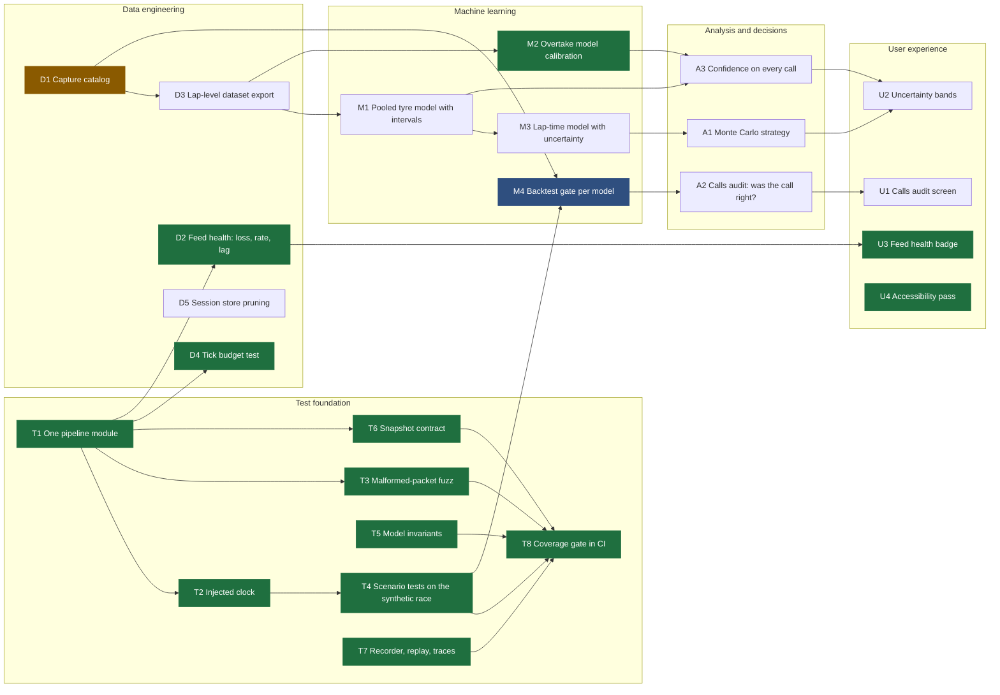

# Roadmap

The work plan as a dependency graph. Each node is one shippable change with a **test that defines
done**, written before the code it checks. A node is *ready* when every node it depends on is done.
Work loop: pick a ready node, write its tests from the acceptance line (they must fail first), make
them pass without editing the assertions, measure, mark it done here.

Green: done. Blue: partly done. Amber: ready next.

## Nodes

Each line: what it is, why it matters, and the acceptance test.

### Test foundation

- **T1 One pipeline module.** The engine was wired by hand in four places (live bridge, capture
  analyzer, demo builder, tests), so a fix in one could miss the others. `src/pipeline.js`
  builds field model → analysis → insights → focus → snapshot once.
  *Test:* `test/pipeline.test.js`: packets in, snapshot out, same as wiring it by hand.
- **T2 Injected clock.** Card expiries and settle timers read `Date.now()`, so replays and tests
  had to patch the global. The pipeline takes a `now()`; replays pass the capture's clock.
  *Test:* two replays of the same packets at different wall-clock speeds give identical calls.
- **T3 Malformed-packet fuzz.** The bridge listens on the LAN and trusts UDP bytes. Seeded random,
  truncated and bit-flipped packets go through the whole pipeline.
  *Test:* no exception escapes, every snapshot is valid JSON with finite numbers, and a clean
  session played afterwards gives the same snapshot as without the fuzz.
- **T4 Scenario tests.** The synthetic race scripts a tyre cliff, a rival stop, an attack from
  behind, a VSC and a shrinking fuel margin. *Test:* each scripted cause produces its call within
  a set time, and never before the cause.
- **T5 Model invariants.** Properties that must hold for any input, checked on many seeded random
  cases. *Test:* the rejoin position never improves with more pit loss and stays inside the field;
  AUC ignores monotone rescaling; the wear fit recovers a known slope through noise; rival stop
  estimates are never negative and never past the flag.
- **T6 Snapshot contract.** The dashboard reads about 100 snapshot fields; a rename on the server
  blanks a card without any error. *Test:* every field `public/` reads exists in a real snapshot.
- **T7 Recorder, replay, traces.** *Test:* record → replay gives back identical bytes in order;
  lap traces survive a flashback; mini-sectors add up to the lap time.
- **T8 Coverage gate.** *Test:* CI fails below the line coverage measured when this lands.

### Data engineering

- **D1 Capture catalog.** `captures/index.json`: track, session type, laps, stops, packet counts,
  quality per capture, so accuracy and training pick races by query, not by hand.
- **D2 Feed health.** *Done.* Packet rate and loss over the last 10 s, from Car Telemetry's overall
  frame counter, measured against its usual step (1 frame at 60 Hz, 3 at 20 Hz) so the send rate
  isn't read as loss, and a pause isn't either. In the snapshot (`feed`) and the capture report.
  *Tests:* every 10th packet dropped reads 10%, random 5% averages 5%, a 30 s pause reads 0%.
  On the Suzuka capture: 51 packets a second, 0% lost (localhost).
- **D3 Lap-level dataset.** One tidy row per car per lap (tyre, age, fuel, gap, lap time, flags)
  from every capture, schema documented, feeding M1-M3.
- **D4 Tick budget.** *Test:* a full synthetic race keeps the mean engine tick under 2 ms.
- **D5 Session store pruning.** Keep the newest 50 debriefs on disk.

### Machine learning

- **M1 Pooled tyre model.** Wear rates pooled across cars and races with a prediction interval,
  scored against the per-race fit in `docs/accuracy.md`.
- **M2 Overtake calibration.** *Done:* Brier score, Brier skill and a held-out reliability table
  are in [ml-overtake-model.md](ml-overtake-model.md). It is well calibrated (20-40% predicted,
  33% observed) but doesn't beat the gap-only baseline yet.
- **M3 Lap-time model.** Fuel + tyre age + traffic, with residual spread, feeding A1.
- **M4 Backtest gate.** Every model scored per race in CI against its baseline; a change that makes
  a model worse than it was fails the build. *Partly done:* rejoin, battery, attack forecast and
  (new) the tyre model are scored per race against a baseline in [accuracy.md](accuracy.md), but
  locally - the captures are too large for the repo, so CI can't gate on them yet (needs D1/D3:
  a small committed lap-level dataset).

### Analysis and decisions

- **A1 Monte Carlo strategy.** One-stop vs two-stop as a distribution of finishing positions,
  not one number.
- **A2 Calls audit.** After the race, each BOX/PUSH/HOLD call graded against what then happened.
- **A3 Confidence on calls.** Every call carries how sure it is, from M1/M2 intervals.

### User experience

- **U1 Calls audit screen** in the Debrief. **U2 Uncertainty bands** on rejoin and gap charts.
  **U3 Feed health badge** (*done*): the link chip says "Live · 8% lost" from 2% loss, and nothing
  extra when the feed is fine. **U4 Accessibility** (*done*): every text colour on every background at
  4.5:1 or more (dashboard and website), every control on every screen named for a screen reader,
  tabs that say which is selected, and a new call (PUSH → BOX) announced, not only drawn.

## What the tests found

Each of these was a failing test before it was a fix; none was found by reading the code.

| Test | Found | Fix |
|---|---|---|
| T3 fuzz | A packet with a NaN tyre-wear float stuck in the wear history; the wear rate read "null" for the rest of the stint. | A non-finite float marks the packet corrupt (none in 2.26M captured packets). |
| T5 invariants | The tyre fit's outlier trim applied indices from the fitted rows to the raw laps, so one car with too few laps on a compound shifted which laps were dropped. | Each row carries its lap. Held-out Monaco error 147 → 130 ms. |
| T5 invariants | Late-stint traffic (1-3 s, under the slow-lap filter) tilts the wear fit by up to 49 ms/lap on synthetic laps. | Not fixed: re-trimming fixed it there but predicted held-out cars worse on Suzuka. Kept as a `todo` test. |
| T4 scenarios | Damage read "front wing l 12%" on the radio, the voice answer and the card; an existing test asserted that text. | "front-left wing". |
| U4 accessibility | A new call (PUSH → BOX) was drawn but never announced to a screen reader; the voice-command phrase box had no label; the website's dim grey was 3.9:1. | A polite live region that speaks the call when the action changes (not its ticking numbers); a label; a lighter grey (5.1:1). |
| D4 budget | The tick-time budget failed in full test runs (p99 11 ms) even before any change: other test files run in parallel. | The mean is now CPU time, which contention can't inflate; a planted 3 ms stall still fails it. |
| T6 contract | (Mutation check) 5 of 5 snapshot field renames now fail a test; before, all 5 passed silently. | - |

Mutation checks - a test only counts once it fails on a planted bug:

- Model invariants: 6 of 8 planted bugs caught; the 2 survivors (a looser outlier trim, a break-even
  stop counted as worth it) each got the missing test, and are caught now.
- Dashboard contract: the first version (no "undefined"/"NaN" on screen) caught 0 of 5 field renames,
  because widgets show "–" for a missing field. Tracking every field a widget reads catches 5 of 5.
- Scenarios: 2 of 4 caught by the scenario tests, 3 of 4 by the whole suite. Not caught by anything:
  how long a card stays up (15 s vs 60 s) - no test pins card lifetimes yet.
