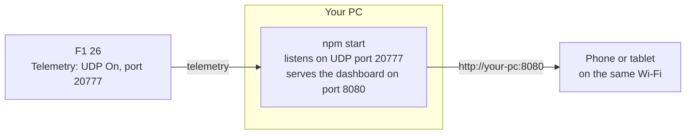
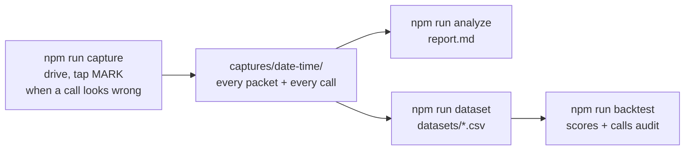

# Setup

[← Back to the README](../README.md)

## The Windows app

Install it with `dist/Undercut-Setup-<version>.exe` (build it with `npm run app:build`). It installs
for your Windows user only, with no admin rights. SmartScreen warns about an unsigned app the first
time: *More info → Run anyway*. Windows Firewall may ask whether Undercut can use the network: allow it
on private networks, or phones (and the game on a console) can't reach it.

It opens on **Home**, a full-window page with one bar into each part of the app: the live dashboard
(position, lap and the current call once the game is connected), race analysis, Ask the race, Storage
and Connect. Live dashboard is the dashboard, with the left rail of race screens (keys
**1–6**, Home at the top). The others are places of their own that fill the window, with a **← Home**
button; Esc goes back too. The content scales with the window: it is laid out for 1440 x 900, and a
bigger or smaller window zooms the whole page (between 80% and 175%), so a 4K or ultrawide screen isn't
left mostly empty.

| Screen | What you do there |
|---|---|
| **Connect** | See whether F1 26 telemetry is arriving, with the game settings to change if not. Scan the QR code on a phone or tablet. Turn off sharing on the Wi-Fi, or turn on *Voice questions on phones* (below). **Record this session** saves every packet and call, like `npm run capture`; MARK appears while it records. |
| **Race analysis** | Every saved session, listed down the left. **Overview**: the result, best lap, stints to scale, your position lap by lap and the key moments. **Pace**: every lap by tyre, each stint's pace and wear, sectors, a sortable lap table and CSV. **Lap vs lap**: any lap of yours against another or a rival's best: speed, throttle, brake, gear and steering on one distance axis, the corners ranked by time lost. **Head to head**: you against any car, lap by lap and where on the lap. **Strategy**: every call graded, your stops priced against the field's. **Full debrief**: the dashboard's Debrief for the same session. **All races** (top of the list): pace per track across your sessions, tyre wear by compound, and how the calls did across races. **Ask about this session** opens it in Ask the race. |
| **Ask the race** | Questions about a saved session, answered by a small model running on this PC through [Ollama](https://ollama.com/download) (install it once). A chat: pick the session and the model, ask, and each answer comes with its chart and how it was worked out; the chart buttons draw lap times, positions, tyre pace by stint, time lost lap by lap, the gap to a driver or two laps' speed with no model, and the Insights buttons show the engine's own findings (race summary, pit stops, tyres, lost time, race pace, calls, history) with no model either; trends carry the range they could be, and every answer says it can be wrong and rests on one session. It summarizes the race, reviews your stops against the field's, reports each tyre stint, finds the laps that cost time and what was recorded on them, ranks race pace across the field, grades the engineer's calls and compares your races at the track. It coaches too: what to do better corner by corner, lift and coast, brake bias and differential from what the car did at each corner, and the battery. **Manage models** downloads and deletes the models (sizes and licences listed). Not for use while racing: questions and downloads are off while the game sends telemetry, and the model leaves memory after each answer. |
| **Storage** | Disk use per kind of data, every saved session (open it in Race analysis, or delete it) and every recording (replay it through the screens, analyze it to check each call, show the file, or delete it). Deletes ask first and can't be undone. |
| **Settings** | As before, plus the two ports and the data folder. |

**Voice in the app window** uses Windows' own speech recognition, offline. It listens for the Ask
questions (and your own commands) by name, so "Engineer, gap behind?" is heard reliably, and nothing is
sent anywhere. The engineer's spoken calls use the Windows voices.

**Voice on phones:** *Voice questions on phones* (Connect) serves the dashboard over https with a
certificate the app makes for this PC. The first time, the phone warns that the connection isn't private
(no company signed it): tap *Advanced → Proceed*, and the microphone works after that.

**Where things are:** race data in `%APPDATA%\Undercut\data` (`race.db`, `sessions/`, `tracks.json`,
`captures/`). *Open data folder* in Storage or Settings opens it. Ollama keeps its models in its own
folder (`%USERPROFILE%\.ollama`).

**Re-processing recordings** into the app's race store, after an update that keeps more per session, so
past races get it too: close Undercut, back up `race.db`, then in PowerShell from the repo run
`npm run db -- --db "$env:APPDATA\Undercut\data\race.db" (Get-ChildItem "$env:APPDATA\Undercut\data\captures").FullName`.

## Try the demo (no game needed)

In the app: **Watch the demo race** on Home. From the code, you need [Node.js](https://nodejs.org) 22.13 or newer.

```bash
git clone https://github.com/srikarnadella/f1-race-engineer.git
cd f1-race-engineer
npm install
npm run demo
```

Open **http://localhost:8080**. Keys **1–6** switch screens, and **Settings → Auto-switch screens**
lets it follow the race on its own.

The demo replays a *made-up* session through the real engine: a scripted five-lap race at the Red
Bull Ring, written out as genuine game packets so every call fires in turn (a tyre cliff, a rival
pitting, a car attacking from behind, a VSC, fuel running short). It's not real game data, and the
dashboard marks it as **Demo replay**. The [website demo](https://srikarnadella.github.io/f1-race-engineer/)
replays a real race instead.

## Use it with the game



1. **On your PC:** `npm install`, then `npm start`. It prints the address to open and a QR code:
   ```
   [server] dashboard: http://localhost:8080
   [server] on other devices (same Wi-Fi): http://192.168.1.23:8080
   [udp] listening for F1 telemetry on 0.0.0.0:20777
   ```
2. **In F1 26:** *Settings → Telemetry Settings*: UDP Telemetry **On**, UDP Port **20777**, UDP Send
   Rate **20Hz** or higher, UDP Format **2025** or later. If the game runs on a console or another PC,
   set *UDP IP Address* to your PC's address.
3. **On your phone or tablet:** scan the QR code (it's also under **Settings** in the dashboard).
   *Add to Home Screen* makes it a full-screen app.

### Options

Pass them through npm, like `npm start -- --port 9000`.

| Option | Default | What it does |
|---|---|---|
| `--port <n>` | `8080` | The dashboard's port |
| `--udp-port <n>` | `20777` | The telemetry port (match the game) |
| `--udp-host <addr>` | `0.0.0.0` | Use `127.0.0.1` if the game is on the same PC and you want it local-only |
| `--demo <file>` | – | Replay a recording instead of listening live |
| `--speed <n>` | `1` | Replay speed for `--demo` |
| `--record <file>` | – | Also save every raw packet to a file |
| `--capture` | – | Save a full capture for checking the tool (below) |
| `--https-cert <file>` `--https-key <file>` | – | Serve over https, so a tablet can use voice (below) |

### What gets saved

Everything stays on your PC:

- **Finished sessions** go to `data/sessions/` and come back in the Debrief after a restart (the newest 50 are kept).
- **What a race measured at a track** (pit loss, when the AI stopped, tyre wear rates) goes to
  `data/tracks.json`, so the next race there starts from real numbers.
- **Every session as SQL tables** goes to `data/race.db` ([how it's laid out](race-store.md)).

### Voice on a phone or tablet

Browsers only let a page use the microphone over https. With [mkcert](https://github.com/FiloSottile/mkcert):

1. `mkcert -install`, then `mkcert 192.168.1.23 localhost` (use your PC's address).
2. Install mkcert's root certificate on the tablet (`mkcert -CAROOT` shows where it is).
3. Start with `npm start -- --https-cert 192.168.1.23+1.pem --https-key 192.168.1.23+1-key.pem`.

The QR code then points at the https address. On the PC itself, `http://localhost:8080` already counts
as secure.

## Record a race and check the tool against it

This is how I test changes against real races.



`npm run capture` is `npm start` plus a full record of the session:

```
captures/2026-10-15_201500/
  packets.f1log.gz   every raw packet (survives a crash or Ctrl+C)
  outputs.jsonl      every call and radio message the dashboard showed
  markers.jsonl      your marks, with lap, position and speed
  meta.json
```

While driving, tap **MARK** (or press **M**) whenever a call looks wrong or is missing, or you lock up,
spin or understeer. One tap saves the moment; the tag sheet that pops up is optional.

Afterwards:

- **`npm run analyze`** (newest capture, or `-- captures/<folder>`) writes `report.md` next to it:
  - **Checks:** packet sizes, fuel, forecast timing.
  - **Laps:** times, tyres, wear, fuel and battery.
  - **Your marks:** each one with what was on screen at that moment.
  - **Timeline:** every call the current code makes.
- **`npm run dataset`** adds the races to the committed datasets (`datasets/races.csv`, `laps.csv`, `calls.csv`).
- **`npm run backtest`** scores the models on them and grades every call. If a score changed only because
  there's more data, `npm run backtest -- --update` saves the new baseline.
- **`npm run db`** adds the sessions to the SQL race store.

For a capture, set the UDP send rate to **60Hz**. A full race is a few hundred MB. Replay any capture
with `node src/index.js --demo captures/<folder>/packets.f1log.gz` (add `--speed 8` to go faster).
