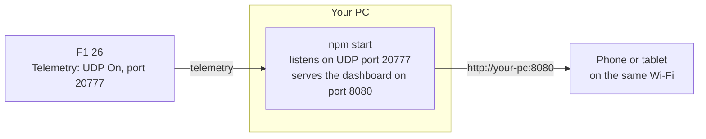
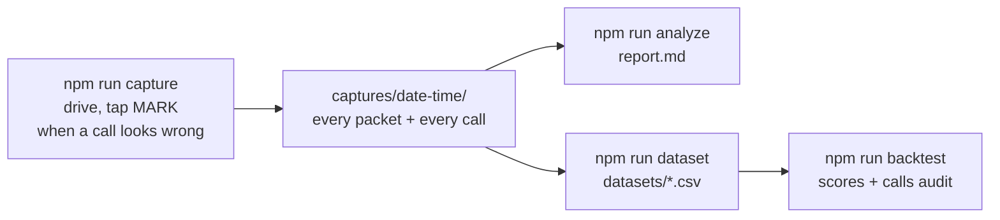

# Setup

[← Back to the README](../README.md)

## Try the demo (no game needed)

You need [Node.js](https://nodejs.org) 18.3 or newer.

```bash
git clone https://github.com/srikarnadella/f1-race-engineer.git
cd f1-race-engineer
npm install
npm run demo
```

Open **http://localhost:8080**. Keys **1–6** switch screens, and **Settings → Auto-switch screens**
lets it follow the race on its own.

The demo replays a *made-up* session through the real engine: a scripted five-lap race at the Red
Bull Ring, written out as genuine game packets so every call fires in turn (a tyre cliff, a rival
pitting, a car attacking from behind, a VSC, fuel running short). It's not real game data, and the
dashboard marks it as **Demo replay**. The [website demo](https://srikarnadella.github.io/f1-race-engineer/)
replays a real race instead.

## Use it with the game



1. **On your PC:** `npm install`, then `npm start`. It prints the address to open and a QR code:
   ```
   [server] dashboard: http://localhost:8080
   [server] on other devices (same Wi-Fi): http://192.168.1.23:8080
   [udp] listening for F1 telemetry on 0.0.0.0:20777
   ```
2. **In F1 26:** *Settings → Telemetry Settings*: UDP Telemetry **On**, UDP Port **20777**, UDP Send
   Rate **20Hz** or higher, UDP Format **2025** or later. If the game runs on a console or another PC,
   set *UDP IP Address* to your PC's address.
3. **On your phone or tablet:** scan the QR code (it's also under **Settings** in the dashboard).
   *Add to Home Screen* makes it a full-screen app.

### Options

Pass them through npm, like `npm start -- --port 9000`.

| Option | Default | What it does |
|---|---|---|
| `--port <n>` | `8080` | The dashboard's port |
| `--udp-port <n>` | `20777` | The telemetry port (match the game) |
| `--udp-host <addr>` | `0.0.0.0` | Use `127.0.0.1` if the game is on the same PC and you want it local-only |
| `--demo <file>` | – | Replay a recording instead of listening live |
| `--speed <n>` | `1` | Replay speed for `--demo` |
| `--record <file>` | – | Also save every raw packet to a file |
| `--capture` | – | Save a full capture for checking the tool (below) |
| `--https-cert <file>` `--https-key <file>` | – | Serve over https, so a tablet can use voice (below) |

### What gets saved

Everything stays on your PC:

- **Finished sessions** go to `data/sessions/` and come back in the Debrief after a restart (the newest 50 are kept).
- **What a race measured at a track** (pit loss, when the AI stopped, tyre wear rates) goes to
  `data/tracks.json`, so the next race there starts from real numbers.
- **Every session as SQL tables** goes to `data/race.db` ([how it's laid out](race-store.md)).

### Voice on a phone or tablet

Browsers only let a page use the microphone over https. With [mkcert](https://github.com/FiloSottile/mkcert):

1. `mkcert -install`, then `mkcert 192.168.1.23 localhost` (use your PC's address).
2. Install mkcert's root certificate on the tablet (`mkcert -CAROOT` shows where it is).
3. Start with `npm start -- --https-cert 192.168.1.23+1.pem --https-key 192.168.1.23+1-key.pem`.

The QR code then points at the https address. On the PC itself, `http://localhost:8080` already counts
as secure.

## Record a race and check the tool against it

This is how I test changes against real races.



`npm run capture` is `npm start` plus a full record of the session:

```
captures/2026-10-15_201500/
  packets.f1log.gz   every raw packet (survives a crash or Ctrl+C)
  outputs.jsonl      every call and radio message the dashboard showed
  markers.jsonl      your marks, with lap, position and speed
  meta.json
```

While driving, tap **MARK** (or press **M**) whenever a call looks wrong or is missing, or you lock up,
spin or understeer. One tap saves the moment; the tag sheet that pops up is optional.

Afterwards:

- **`npm run analyze`** (newest capture, or `-- captures/<folder>`) writes `report.md` next to it:
  - **Checks:** packet sizes, fuel, forecast timing.
  - **Laps:** times, tyres, wear, fuel and battery.
  - **Your marks:** each one with what was on screen at that moment.
  - **Timeline:** every call the current code makes.
- **`npm run dataset`** adds the races to the committed datasets (`datasets/races.csv`, `laps.csv`, `calls.csv`).
- **`npm run backtest`** scores the models on them and grades every call. If a score changed only because
  there's more data, `npm run backtest -- --update` saves the new baseline.
- **`npm run db`** adds the sessions to the SQL race store.

For a capture, set the UDP send rate to **60Hz**. A full race is a few hundred MB. Replay any capture
with `node src/index.js --demo captures/<folder>/packets.f1log.gz` (add `--speed 8` to go faster).
