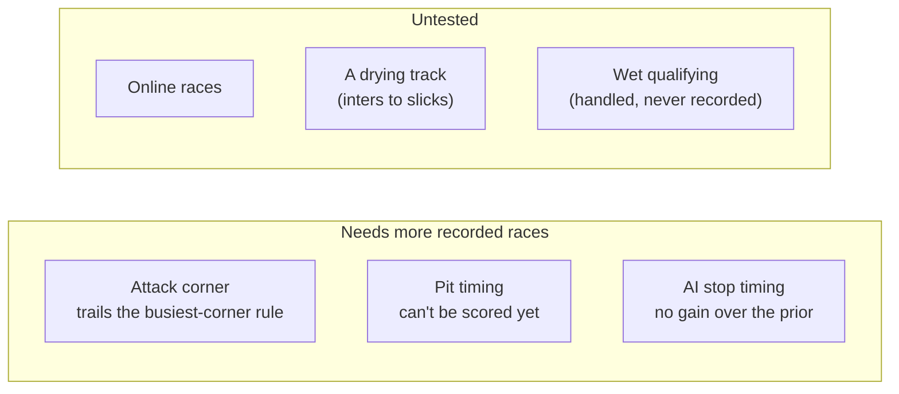

# Status and what's next

[← Back to the README](../README.md)

## What works

The live tool, voice, the debrief and the models all work end to end, and I've run them against real
F1 26 races. Things I've checked against recordings of the real game (not just the spec):

- the 2026 packet layouts, including the new Car Telemetry 2 packet and a field F1 26 inserted mid-packet;
- fuel, which the game reports as the surplus over the race distance, not laps of fuel left;
- the 4 MJ battery, and setup changes made in the car's menu showing up in the data;
- the weather forecast, which counts minutes from now (100% of 299 checks in a race where the rain came);
- every car's speed, throttle, brake and tyre wear, offline.

## Still open

- **More races for the models.** The attack forecast trails the busiest-corner rule. The rejoin prediction
  beats its guess (3.13 places off against 6.37) but is still about 1.7 places pessimistic. (The overtake model needed them too: on 11 races LightGBM beats the
  gap, AUC 0.866 vs 0.837, where a logistic regression on 4 had tied it.)
- **Scoring pit timing** needs races where the same stop was made on different laps.
- **Damage cost on a full lap:** in every race so far I undid the damage with a flashback within a few
  corners, so this is only tested on made-up laps. The 6 s a nose change adds to a stop is a guess.
- **When the AI stops:** learning from the stops already made in a race now beats the fixed starting guess of
  60% of rated tyre life (1.53 laps off against 1.73 on 86 stops), but the first stops a race sees are the early ones.
- **Online races** are untested: human drivers don't stop like the AI, and other cars' data may be hidden.
- **Tyre temperature calls:** the 8 °C and 12 °C thresholds come from four races, not from tyre data.
- **The race plan** looks at one and two stops; a full-distance race can need three.
- **Sprints and 5-lap races** have no compulsory stop (no AI car stopped in three 5-lap races), so there's no
  stop plan and no rival due to box. The game calls the sprint "Race", so the tool knows it by the sprint
  shootout earlier in the same recording: start recording at the sprint itself and it's treated as a full race.
  Races of 25% distance and longer keep the compulsory stop.
- **Wet races:** pit timing and undercut calls are dry-only, there's no model of how inters wear, and I've
  recorded one wet race (Austria, 19 Oct 2026) plus 7 minutes of rain in an earlier session. The tyre-wear and rival-stop scores aren't built for
  rain yet, so that race isn't in the committed dataset.
- **An in-game overlay** (drawn over the game itself) is parked in favor of voice; the Windows app is a
  separate window, for a second monitor or between sessions.

## Coming soon

The same list as the website's Next steps page; the full plan is in the [roadmap](roadmap.md).

- **The Windows app** *(built, not released yet)*: Home, the live dashboard, Race analysis, Ask the
  race, Storage and Connect, from one installer. See [setup](setup.md#the-windows-app).
- **Ask the race** *(built, in the Windows app)*: ask about a saved race in plain words and get an answer
  from a small model running on your PC. The engine looks the facts up in the [race store](race-store.md)
  and the model only puts them into words; every number is checked against the recording. Qwen3 4B gets
  49 of 50 test questions right. More in [Ask the race](ask-the-race.md).
- **Confidence on every call** *(in progress)*: the pit-stop pick says when it depends on tyre wear
  ("Lap 14-22, depending on tyre wear"), and the tyre-cliff warning gives a range ("~1-2 laps to the
  cliff, depending on how the wear goes"). The battle calls are next.
- **The calls audit in the Debrief** *(done)*: every call graded against what happened after it, in the Calls tab.
- **A sharper rejoin prediction** *(in progress)*: from 4.2 to 2.7 places off (first 45 stops) by counting the cars
  already stopping and the ones due this lap. On all 79 stops: 3.13, still about 1.7 places pessimistic.
