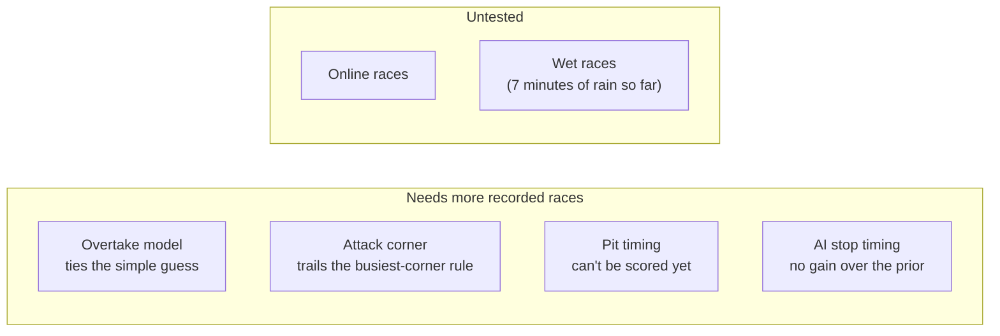

# Status and what's next

[← Back to the README](../README.md)

## What works

The live tool, voice, the debrief and the models all work end to end, and I've run them against real
F1 26 races. Things I've checked against recordings of the real game (not just the spec):

- the 2026 packet layouts, including the new Car Telemetry 2 packet and a field F1 26 inserted mid-packet;
- fuel, which the game reports as the surplus over the race distance, not laps of fuel left;
- the 4 MJ battery, and setup changes made in the car's menu showing up in the data;
- the weather forecast, which counts minutes from now (100% of 299 checks in a race where the rain came);
- every car's speed, throttle, brake and tyre wear, offline.

## Still open

- **More races for the models.** The overtake model ties the gap-only guess and the attack forecast trails
  the busiest-corner rule. The rejoin prediction beats its guess but is too pessimistic.
- **Scoring pit timing** needs races where the same stop was made on different laps.
- **Damage cost on a full lap:** in every race so far I undid the damage with a flashback within a few
  corners, so this is only tested on made-up laps. The 6 s a nose change adds to a stop is a guess.
- **When the AI stops:** learning from the stops already made in a race (1.22 laps off) is no better than
  the fixed starting guess of 60% of rated tyre life (1.24), because the first stops a race sees are the early ones.
- **Online races** are untested: human drivers don't stop like the AI, and other cars' data may be hidden.
- **Tyre temperature calls:** the 8 °C and 12 °C thresholds come from four races, not from tyre data.
- **The race plan** looks at one and two stops; a full-distance race can need three.
- **Wet races:** pit timing and undercut calls are dry-only, there's no model of how inters wear, and I've
  recorded one wet race (Austria, 19 Oct 2026) plus 7 minutes of rain in an earlier session. The tyre-wear and rival-stop scores aren't built for
  rain yet, so that race isn't in the committed dataset.
- **An in-game overlay** needs a desktop wrapper; I parked it in favor of voice.

## Coming soon

The same list as the website's Next steps page; the full plan is in the [roadmap](roadmap.md).

- **Ask the race** *(in progress)*: ask about a race in plain words ("What happened on lap 12?", "Where did
  I lose time to Norris?") and get an answer built from the recorded data. Every session is already stored
  as [tables](race-store.md); a language model will query them and show which laps and events it used.
- **Confidence on every call** *(in progress)*: the pit-stop pick already says when it depends on tyre wear
  ("Lap 14-22, depending on tyre wear"). The tyre-cliff warning and the battle calls are next.
- **The calls audit in the Debrief** *(next)*: every call graded against what happened after it, on screen.
- **A sharper rejoin prediction** *(next)*: it's 2.5 places off on average, nearly all of it too
  pessimistic. Fixing that bias.
